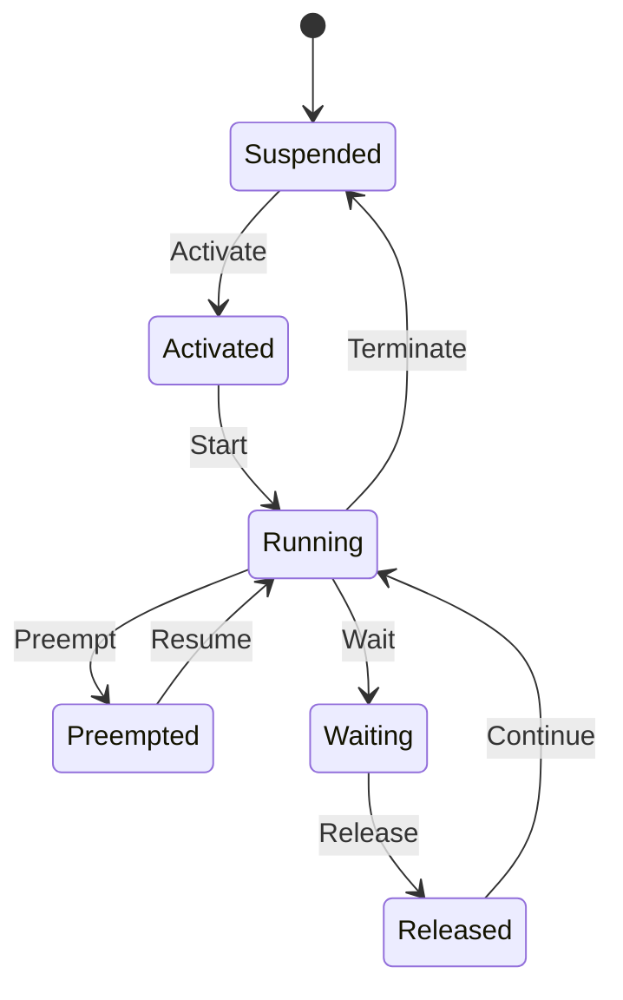

# 自研 AUTOSAR OS 原生支持 ARTI 的开发工作说明

> 2026年10月6日 · @magus wang
>
> **读者是 OS 内核开发者**，不是 ETA 使用者。ETA 侧如何接入 ARTI，见 `docs/ETA使用说明_新手快速入门.md` §4.2④ 与 §8；本文第八节只讲两边怎么对上。
>
> **规范依据分两层**：
> - **AUTOSAR CP SWS ARTI / EXP ARTI R24-11**：原文在仓库 `doc/ARTI/`，本文凡引其条款、图表编号，都已对照原文核过；
> - **SWS OS R21-11**：原文在仓库 `doc/ARTI/AUTOSAR_SWS_OS.pdf`。§7.17（ARTI hook）已逐条核对，事件名与参数以它为准；其余章节号未逐条核对。

---

### 一、概述与工作分解

OS 要"原生支持 ARTI"，需交付三样东西：
1. **一份可被调试/Trace 工具解析的 ARTI 描述**
2. **一套关闭时零开销的 hook 调用接口**
3. **在 OS 状态迁移原子时刻发出的 `ARTI_TRACE` 事件**

ARTI 包含两部分，OS 两部分都要交付：
- **ARTI 调试信息（SWS OS §7.16）**：ORTI 的继任者。描述 OS 内部对象与变量，供调试器在停机时做 OS-aware 显示。
- **ARTI Hook 宏（SWS OS §7.17）**：插桩 trace，供运行时记录任务、ISR2、Spinlock、服务调用等事件。

#### 模块分解

| 模块 | 工作内容 | 产出 |
| :--- | :--- | :--- |
| **1. 配置与生成器** | 实现 SWS ARTI Chapter 10 标准 `/AUTOSAR/EcucDefs/Arti` 容器；生成 ARTI 描述 ARXML 与 ORTI；ID 一致性与 Schema 自检 | BSWMD/ParamDef、生成器、ARXML/ORTI |
| **2. 接口与解耦** | 包含 `Os_Arti.h`；定义 OS 私有包装宏；编译开关保证零开销 | `Os_ArtiHooks.h`（命名可自定） |
| **3. 内核插桩** | `AR_CP_OS_TASK`/`AR_CP_OSARTI_TASK` / `CAT2ISR` / `SPINLOCK` / `SERVICECALLS` / `APPLICATION` / `HOOK` 各 class 的埋点 | 内核源码 |
| **4. 验证** | Mock `Os_Arti.h`、状态机合法性检查、多核与强制终止用例、CI Schema 校验 | 测试套件 |
| **5. 文档** | 集成手册：支持的 class、状态机模型、参数约定、调用上下文 | 集成手册 |

> [!NOTE]
> **不在 OS 职责内的工作**：
> - **Cat1 ISR 埋点**：由用户在自身 ISR1 中手工放置。
> - **`Arti.h` / `Os_Arti.h` 的实现**：由 Trace 工具厂商或底层记录库提供（ETA 的实现在 `target/eta/include/arti/`）。
> - **RTE runnable hook**：由 RTE/VFB tracing 负责提供。

---

### 二、配置模型与描述文件生成

ARTI 描述是 AUTOSAR 标准中**独立的 `Arti` 模块**（`/AUTOSAR/EcucDefs/Arti`，SWS ARTI Chapter 10）的 ECUC configuration values ARXML。它不是挂在 `/AUTOSAR/EcucDefs/Os` 下的私有容器，也不采用在实例上直接扁平挂载属性的建模方式，而是遵循 **Class / Instance 分离** 与 **TypeMap 间接引用** 模型（与 ORTI 的 IMPLEMENTATION/INFORMATION 分离架构一脉相承）。

#### 1. 标准容器体系（SWS ARTI Chapter 10）

ARTI 根模块（`Arti`）下与 OS 交付相关的分支是 `ArtiHardware`、`ArtiOs` 和 `ArtiValues`（另有 `ArtiRte`、`ArtiGeneric`，不属于 OS 交付）。

> **定义出处不同**：SWS ARTI R24-11 第 10 章（§10.4、§10.5）只画出了 `ArtiHardware`、`ArtiOs` 的容器图，并明确写"specified in SWS_OS"，具体容器和参数的定义在 SWS OS 里；`ArtiValues`、`ArtiGeneric`、`ArtiRte` 才在 SWS ARTI 里定义。这两个容器的定义见 SWS OS R21-11 §10.4（`doc/ARTI/AUTOSAR_SWS_OS.pdf`），已据此写入仓库里的 `definitions/Arti/Arti_ParamDef.arxml`（该文件另含 `ArtiGeneric`、`ArtiValues`，已通过 AUTOSAR_00047.xsd 校验）。注意 `ArtiOs*Class` 与 `ArtiOs*Instance` 都是 `ArtiOs` 的直接子容器，不是嵌套关系。

| 顶层容器 | 子容器 / 体系 | 内容与机制说明 |
| :--- | :--- | :--- |
| **`ArtiHardware`** | `ArtiHardwareCoreClass`、`ArtiHardwareCoreInstance`（同级） | 描述硬件核，供多核调度跟踪建立核拓扑。 |
| **`ArtiOs`** | `ArtiOsClass`、`ArtiOsInstance`（同级） | OS 实例。 |
| | `ArtiOsTaskClass`、`ArtiOsTaskInstance`（同级） | **Class / Instance 分离建模**：每个 Task 一个实例。实例只直接存放静态标识（`ArtiOsTaskInstanceId`、`ArtiOsTaskInstanceFunction`）和对 OsTask 的引用 `ArtiOsTaskInstanceEcucRef`；运行时才有的值（当前状态、优先级、栈等）通过 `…Ref` 引用 `ArtiValues` 下的 `ArtiObjectInstanceParameter`，再由它引用表达式、常量或 hook。 |
| | `ArtiOsIsrClass`、`ArtiOsIsrInstance`（同级） | Cat2 ISR 类与实例。 |
| | `ArtiOsAlarm*` / `ArtiOsResource*` / `ArtiOsSpinlock*` / `ArtiOsScheduleTable*` / `ArtiOsMessageContainer*` / `ArtiOsStack*` / `ArtiOsContext*` | 其余 OS 对象的类与实例，供调试显示。 |
| **`ArtiValues`** | `ArtiExpression` | **停机求值表达式**（ECUC_Arti_00009，规范原文"similar to what is already done in ORTI"）：`ArtiExpressionString` 给出调试器停机后求值的 C 风格表达式，如 `Os_ControlledCoreInfo[0U].RunningTask`。 |
| | `ArtiConstant` | 常量值，供对象参数引用。 |
| | `ArtiStates` | 各类对象使用的状态列表。其中布尔参数 **`ArtiStatesTaskEnhanced`**（ECUC_Arti_00032，必填）为 `true` 表示 OS 采用增强任务状态模型，READY 拆为 Activated / Preempted / Released。 |
| | `ArtiParameterTypeMap`<br>└ `ArtiParameterTypeMapPair` | **参数解码字典**：每个 Pair 把 `ArtiParameterTypeMapPairInput`（数值；或经 `ArtiParameterTypeMapPairInputExpressionRef` 取表达式的值）映射为 `ArtiParameterTypeMapPairOutput`（显示字符串）或 `ArtiParameterTypeMapPairOutputRef`（引用某个实例）。**被 ArtiHook 使用时**，`PairInput` 必填且限定在 `0..65535`（ECUC_Arti_00024；参数本身是 64 位整数）。 |
| | `ArtiHook` | **运行时 trace 规格**，每个 hook 宏一条：<br>1. 四个字面 token：`ArtiHookContext`（00014）、`ArtiHookClass`（00013）、`ArtiHookInstance`（00017）、`ArtiHookEventName`（00015）；<br>2. 两个引用：`ArtiHookInstanceParameterTypeRef`（00018）与 `ArtiHookEventParameterTypeRef`（00016），分别指向解码 `instanceParameter`、`eventParameter` 的 TypeMap。规范里两者都是可选项（0..1），但不配时工具只能显示数值，**本 OS 生成器一律生成**。 |

#### 2. 开关参数

- **总开关用标准参数 `OsUseArti`**。EXP ARTI §3.2 写明它实现为宏 `OS_USE_ARTI`，关闭后可以不重新生成代码。THA6 OS 插件里它是 `OsOS` 容器下的布尔参数 `OsUseArti`，与 `OsStatus`（取值 `STANDARD`/`EXTENDED`）是两个参数（据本工具对 THA6 Os 配置的导出 `output/Os/Os_PBcfg.c`；生成的宏名未核对）。不要另起私有总开关。
- **状态模型开关**：
  - ARXML 侧：标准参数 `ArtiValues/ArtiStates/ArtiStatesTaskEnhanced`（布尔，必填）。采用增强模型时设为 `true`，工具据此把 READY 拆分为 Activated、Preempted、Released 三种就绪子状态。
  - C 宏侧：私有扩展参数 `OsVendorArtiStateModel`（`STANDARD` 或 `ENHANCED`，默认 `ENHANCED`），决定包装宏使用 `AR_CP_OS_TASK` / `AR_CP_OS_CAT2ISR` 还是 `AR_CP_OSARTI_TASK` / `AR_CP_OSARTI_CAT2ISR`。
  - 两者必须由生成器从**同一个配置项**同时产出，不允许分别配置：ARXML 声明增强而代码发标准事件（或反之），工具会把状态机画错。
- **Vendor 私有扩展**：
  - `OsVendorArtiTrace<Class>`：按 class 单独开关的六个布尔参数（`Application`、`Task`、`Cat2Isr`、`ServiceCalls`、`Spinlock`、`Hook`，只有 `ServiceCalls` 默认关闭）。其中 `HOOK` 在真实 Trace32 抓包中未出现（抓包里是 `ERROR`/`EVENT`），枚举最终取值待第九节第 1 条核实 SWS OS 后定稿。
- **开关只到 class 粒度，对象级不在内核过滤**：
  - 内核对所有 Task/ISR2 无条件发出 `ARTI_TRACE`，不加"这个对象要不要追踪"的判断，开销恒定；
  - 选哪些对象、怎么映射，由工具层决定。内部辅助任务（如空闲任务）也照发。

#### 3. 标准参数与私有扩展

| 参数 | 性质 | 生成器须同步产出 | 工具侧 |
| :--- | :--- | :--- | :--- |
| `OsUseArti`、`ArtiStatesTaskEnhanced`、`Arti*` 容器 | 标准（SWS OS / SWS ARTI Chapter 10） | ARTI ARXML、`OS_USE_ARTI` | 所有工具都认 |
| `OsVendorArtiStateModel` | **本 OS 私有** | 包装宏选用 `AR_CP_OS_TASK` 或 `AR_CP_OSARTI_TASK`，同时写 `ArtiStatesTaskEnhanced` | 工具只能从 ARXML 的 `ArtiStatesTaskEnhanced` 和 hook 的 class 名看到结果，看不到这个参数本身 |
| `OsVendorArtiTrace<Class>` | **本 OS 私有** | 各 class 的包装宏展开与否；同时 `ArtiHook` 容器里不生成被关闭 class 的条目 | 工具不认；关闭的 class 在 ARXML 里必须消失，否则工具会等不到事件 |

约定：
- 私有扩展只影响 OS 自己的生成物，不得改变 ARTI ARXML 的标准结构。
- 私有扩展与标准参数的联动（如上表第二、三行）必须由生成器从同一个配置项产出。
- `AR_CP_VOID` 不属于私有扩展，是 SWS_Arti_00016 规定的标准类（见第三节第 2 条）。
- Trace32 抓包里的 class / event 名是工具行为，不是私有扩展，对照见第五节。

#### 4. 生成器要求

1. **强一致性底线（三位一体校验）**：
   - ARTI 文件通过内部的 `ArtiParameterTypeMap` 自带 `ID → 对象` 映射，理论上具备自洽性；
   - 但在工程交付中，`Os_Cfg.h` 中的 `TaskType`/`ISRType` 数值枚举、ARTI 中的 `ArtiParameterTypeMapPairInput`、以及（若双轨交付）ORTI ENUM 中的索引，**三者必须 100% 严格一致**。生成器在输出前自检，不一致即报错。
2. **TypeMap 16 位输入上限约束**：
   - 被 `ArtiHook` 引用的 TypeMap，其 `ArtiParameterTypeMapPairInput` 限定为 `0..65535`（ECUC_Arti_00024）。
   - **架构约束**：禁止在 C 宏中将复合数据（例如 `(core << 16) | task_id`）打包进单个 `eventParameter` 并寄希望于 TypeMap 解码。核号必须走 `instanceParameter`，任务 ID 必须走 `eventParameter`。
3. **CI 增加 Schema / ParamDef 校验**：
   - CI 校验脚本不仅要核对 ID 一致性，还必须使用标准的 `Arti_ParamDef.arxml` 校验生成的 ARXML 文件的结构与 DEFINITION-REF 路径，防止出现凭空捏造参数或模块路径错误的情况。
4. **hook 描述与代码同源生成**：
   - `ArtiHook` 容器里的四个字面值，必须与内核调用 `ARTI_TRACE` 时传的 token **逐字相同，包括大小写**。私有包装宏（第三节）与 `ArtiHook` 容器必须由生成器从同一份配置数据产出。
5. **符号保留与防优化（抗 LTO / `--gc-sections`）**：
   - `ArtiExpression` 中引用的内核符号（如 `Os_ControlledCoreInfo[0U].RunningTask`）必须在链接后的 ELF/DWARF 中真实存在；
   - 内核本身会读写的变量（如 `RunningTask`）不会被裁掉；有风险的是**只给调试器看、代码里没有引用**的变量，两层优化都可能删掉它：
     - 编译器 / LTO：用 `__attribute__((used))` 保护；
     - 链接器 `--gc-sections`：`used` 挡不住，须在链接脚本里对其所在段使用 `KEEP`，或用 `__attribute__((retain))`（GCC ≥ 11，需目标格式支持 `SHF_GNU_RETAIN`）。
   - 单纯使用 `volatile` 只能保证访问不被优化掉，阻止不了未被引用的符号被裁剪。

---

### 三、头文件与编译开关

OS 只调用自己的私有包装宏，从不定义 `ARTI_TRACE` 本身。开启时包装宏展开为 `Os_Arti.h` 提供的 `ARTI_TRACE`，关闭时展开为 `((void)0)`，宏的参数被整个丢弃、不会求值。

**零开销的前提：为 hook 准备参数的代码也必须随开关消失。** 关闭时 `((void)0)` 只能丢掉宏调用本身，调用前为取参数而写的语句（如 `CoreIdType cid = Os_GetCoreIdFast();`）仍会留在内核里：
- 若取值涉及函数调用或 `volatile` 读，编译器不能删掉它，关闭 ARTI 后仍有额外开销；
- 变量只被 hook 使用时，关闭后还会出现 unused-variable 警告。

所以这类局部变量一律用 `OS_ARTI_DECL_CORE()`（见下面第 3 小节）声明，关闭时整条消失；其它只为 hook 服务的临时变量同理。第七节第 1 条的"开关前后代码段比对"要覆盖这一点。

#### 1. 头文件归属

R22-11 起（SWS ARTI 变更记录："Splitted arti.h in module depending header files"），结构是：

- OS 源码 `#include "Os_Arti.h"`；
- `Os_Arti.h` 在任何模块宏之前 `#include "Arti.h"`；
- 两个文件都由 hook 实现方（Trace 工具）提供（SWS ARTI §7.2）。

R21-11 还是单一的 `arti.h`。**若本 OS 的基线仍是 R21-11，也建议直接按 R22-11+ 的结构包含 `Os_Arti.h`**，原因有两个：

- 按新版交付的工具（ETA 交付的是 R24-11 的 `Arti.h` + `Os_Arti.h`）可以直接对接，不需要集成方再写一个转发头；
- 大小写：Linux 上 `#include "arti.h"` 找不到 `Arti.h`。Windows/macOS 默认不区分大小写，能找到 `Arti.h`，但映射都在 `Os_Arti.h` 里，结果仍是编译失败。

OS 交付物中只附带一份用于编译和测试的 stub `Os_Arti.h` / `Arti.h`，不作为产品代码。

#### 2. 为什么不在 OS 内部 `#define ARTI_TRACE` 为空？

EXP Listing 3.1 的示例确实这么写（`#ifdef OS_USE_ARTI` 包含 `Os_Arti.h`，否则把 `ARTI_TRACE` 定义成 `((void)0)`）。但 `ARTI_TRACE` 是全局宏名，RTE 的 runnable hook 也在使用。若 OS 关闭 ARTI 时自行定义空的 `ARTI_TRACE`，在 RTE 开启 ARTI 的工程里会出现宏重定义冲突，或者悄悄吞掉 RTE 的 trace。用私有包装宏可以避开这个问题。

**`AR_CP_VOID` 不是 OS 用来关闭 hook 的手段。** SWS_Arti_00016（SWS ARTI §8.7.2.5.4）规定，ARTI 实现方必须提供一个编译为空的 `AR_CP_VOID` 类，用途是"映射 ARTI 不使用的 VFB tracing hook"，也就是 RTE 那一侧的东西。OS 要关掉某个 class，在包装宏里按私有开关直接展开为 `((void)0)` 即可，不需要绕道 `AR_CP_VOID`。

#### 3. 推荐写法

```c
/* Os_ArtiHooks.h —— 由生成器产出的 OS 内部头文件，不对外导出 */
#ifdef OS_USE_ARTI                      /* 标准参数 OsUseArti 生成的宏(EXP ARTI §3.2) */
    #include "Os_Arti.h"
    /* NOSUSP / 类名 / Os / 事件名 都必须是字面 token:ARTI_TRACE 的实现普遍对它们做 ## 拼接,
       而 ## 的操作数不做宏展开。所以:
       - 模型选择只能用 #if 写两套,不能做成 OS_ARTI_TASK_CLASS 宏再传进去;
       - 实例名 "Os" 由生成器直接写成 ArtiHookInstance 的值,不能做成 OS_ARTI_INSTANCE_NAME 宏
         再传进去 —— 对做 ## 拼接的实现,拼出来的是 ..._OS_ARTI_INSTANCE_NAME_...,不是 ..._Os_...
         (这是 C 预处理规则的推论;ETA 不使用实例名,不能用来验证,以第七节的 Mock 为准)。 */
    #if (OS_VENDOR_ARTI_TASK_MODEL == OS_ARTI_MODEL_ENHANCED)
        #define OS_ARTI_TASK(ev, core, tid) \
            ARTI_TRACE(NOSUSP, AR_CP_OSARTI_TASK, Os, (core), ev, (tid))
    #else
        #define OS_ARTI_TASK(ev, core, tid) \
            ARTI_TRACE(NOSUSP, AR_CP_OS_TASK, Os, (core), ev, (tid))
    #endif
    #define OS_ARTI_ISR2(ev, core, iid) \
        ARTI_TRACE(NOSUSP, AR_CP_OS_CAT2ISR, Os, (core), ev, (iid))
    /* 为 hook 准备的局部变量:开启时声明并取值,关闭时整条消失 */
    #define OS_ARTI_DECL_CORE(cid, expr)    CoreIdType cid = (expr);
#else
    #define OS_ARTI_TASK(ev, core, tid) ((void)0)
    #define OS_ARTI_ISR2(ev, core, iid) ((void)0)
    #define OS_ARTI_DECL_CORE(cid, expr)
#endif
```

#### 4. 参数约定

- **字面 token**：`_contextName`、`_className`、`_instanceName`、`_eventName` 这四个参数，SWS ARTI §8.7.1.1 写明**"不能是 C 宏、变量、常量、枚举"**。
  - **核心原因**：虽然通过中间封装宏（如 `OS_ARTI_TASK`）实参会被预先展开一次，但 `Arti.h` / `Os_Arti.h` 的底层实现由各工具厂商完全决定——有的工具使用 `##` 进行符号拼接，有的工具则在头文件中将特定 token 映射为枚举、符号或结构体。OS 侧不能对工具实现机制做任何预设，因此调用点必须严格使用字面 Token。
- **取值**：
  - `_contextName` 三选一，定义见 SWS §8.7.1.1：
    - `NOSUSP`：hook 在已关中断的上下文中被调用；
    - `SPRVSR`：hook 可以在调用期间自己关中断，但不得为此调用 OS 函数；
    - `USER`：hook 自己不能关中断，确有需要时必须用 OS 提供的函数。
    - 它是**每个调用点**的编译期属性，必须如实反映该调用点当时的中断状态，与"在任务里还是在 ISR 里"无关。
    - 以调用点实际的中断状态为准。第六节第 2 条要求 Task/ISR2 的 hook 在持内核锁/关中断时调用，这些调用点用 `NOSUSP`；Spinlock、ServiceCalls 入口/出口、Application、HOOK 各 class 的调用点是否持锁，须逐点核对，不能默认写 `NOSUSP`。告警到期激活任务往往发生在定时器 ISR 里，但只要也是在内核锁内调用，同样是 `NOSUSP`。
    - 如果某个平台把告警处理放在可嵌套的中断里、并且不持内核锁就调用 hook，那个调用点就不能写 `NOSUSP`。
    - 对应 `ArtiHook` 容器里的 `ArtiHookContext` 要同步写。
  - `_instanceName` 是任务所属 OS 的名字，对应 `ArtiHook` 容器的 `ArtiHookInstance`（ECUC_Arti_00017）。
    - 规范的说法是 **OS 的短名**：SWS_Arti_00008 给 Cat1 的调用模板里，这个位置写的是 `<OS Short Name>`。但没有规定具体值，两份 EXP 示例本身就不一样：Listing 3.3 写 `OS`，Listing 6.4 的 ARXML 写 `VectorOsOs`。
    - 要紧的是代码里的 token 与 `ArtiHookInstance` **逐字相同，包括大小写**。按 EXP Listing 3.2 的拼接方式，实例名会进入工具展开的宏名，差一个字母就对不上。
    - 做法见第二节第 4 条第 4 项（同源生成），以及上面代码里的注释（不能用宏传）。
- **值参数**：`instanceParameter` 和 `eventParameter` 是值。
  - `instanceParameter` 按 SWS §8.7.1.1 的定义，是"该 `_className` + `_instanceName` 下的实例索引，从 0 起、按 `_instanceName` 连续编号"。
    - 对任务类来说，必须是**该任务被调度运行所在的核（Target Core）**，而不是发出 API 调用的核（调用核）。跨核激活若传调用核，工具会将事件画在错误核的甘特图上。
    - 它是 OS 实例内的逻辑核索引，不一定等于硬件核号（OS 未覆盖全部物理核时两者不同）。逻辑索引到核的对应关系，用 `ArtiHookInstanceParameterTypeRef` 指向的 TypeMap 表达，在 `ArtiParameterTypeMapPairOutput` 里填核名字符串（如 `Core0`）。**不能用 `PairOutputRef` 指向 `ArtiHardwareCoreInstance`**：仓库定义文件 `Arti_ParamDef.arxml` 中 `PairOutputRef`（ECUC_Arti_00027）的 9 个合法目标不含它（见第十节第 6 条）。
  - `eventParameter` 是对象 ID，例如 TaskType。
  - **调用前先取到局部变量**。SWS_Arti_00018 的注释明确说，宏调用里不要放 BSW API 调用，宏展开不保证它被正确求值；例如 `OS_GET_CURRENT_CORE_ID()` 可能被展开多次。
    - 参数里禁止放函数调用和有副作用的表达式，只传局部变量或简单字段；
    - 取参数的局部变量用 `OS_ARTI_DECL_CORE()` 声明，关闭 ARTI 时随之消失（见本节开头）。
- **参数顺序按 SWS_Arti_00018**：`ARTI_TRACE(_contextName, _className, _instanceName, instanceParameter, _eventName, eventParameter)`。EXP Listing 3.1/3.2 把 `_eventName` 放在 `instanceParameter` 前面，两份文档确实不一致，以规范性条款为准，并在集成手册里写明本 OS 用的是哪种顺序。
- **顺序弄反不一定报错，要靠 OS 自己的测试拦住。**
  - 如果工具对 `_eventName` 做 `##` 拼接（ETA 和 EXP 示例都是这样），顺序弄反后核号表达式会被拼进宏名，编译失败。
  - 如果工具把事件名当普通值传，顺序弄反会照常编译，核号被当成事件写进 trace，是静默的错。
  - 所以第七节的 Mock `Os_Arti.h` 必须对 `_eventName` 做 `##` 拼接，这样顺序错误在 OS 自己的 CI 里就编译失败，不依赖对接的是哪家工具。

---

### 四、任务状态机与插桩点

每个 trace 事件必须在对应状态迁移的原子时刻、于同一临界区内发出。

#### 1. 两种模型

**增强模型**（`AR_CP_OSARTI_TASK`，EXP Fig 3.1）。EXP §3.1 说明了引入原因："标准模型分不清被抢占、被释放、被激活三种就绪状态"。所以它把 READY 拆成三个状态，分派时各发一个事件：



**标准模型**（`AR_CP_OS_TASK`，EXP Fig 3.2）只有一个 Ready：Activate、Preempt、Release 都回到 Ready，任何一次分派都发 `Start`。

两条硬约束：
- **Waiting 不能直接回到 Running**。`SetEvent` 只发 `Release`，把任务放回就绪；再由调度器分派，增强模型发 `Continue`，标准模型发 `Start`。真实 Trace32 抓包 `arti_full.mdf`（未入库）的序列即为 `Wait → Release → Continue`，见 `doc/2026-09-21_MDF4读取引擎设计.md`；入库样本 `doc/trace32/arti_selftest_enhanced.mdf` 的增强类值表中 `OsTask_Resume` 与 `OsTask_Continue` 并列。
- **ISR 打断任务不改变任务状态**。

#### 2. 插桩点总表

| 触发位置 | 迁移（增强模型 / 标准模型） | 事件 | instanceParameter | 备注 |
| :--- | :--- | :--- | :--- | :--- |
| `ActivateTask`、告警/调度表到期激活 | Suspended → Activated / Ready | `Activate` | 任务所属核 | 在目标核修改就绪队列处发出 |
| 多重激活（BCC2/ECC2，任务已 READY/RUNNING） | 状态不变，激活计数 +1 | `Activate` | 任务所属核 | 本 OS 默认不发(状态未迁移,迁移表不允许);工具方要求发出时须同步修改迁移表 |
| 调度器分派新激活的任务 | Activated / Ready → Running | `Start` | 执行核 | — |
| 调度器分派被抢占的任务 | Preempted / Ready → Running | `Resume`（增强）/ `Start`（标准） | 执行核 | — |
| 调度器分派被释放的任务 | Released / Ready → Running | `Continue`（增强）/ `Start`（标准） | 执行核 | — |
| 更高优先级任务就绪、ISR 退出时重调度、`Schedule()` | Running → Preempted / Ready | `Preempt` | 执行核 | 先发 Preempt，再发换上任务的分派事件 |
| `WaitEvent` 且所等事件均未置位 | Running → Waiting | `Wait` | 执行核 | 事件已置位时的处理见下文 |
| `SetEvent` 命中所等事件 | Waiting → Released / Ready | `Release` | 任务所属核 | 在目标核发出 |
| `TerminateTask` | Running → Suspended | `Terminate` | 执行核 | — |
| `ChainTask` | 自身 Terminate + 目标 Activate | `Terminate`，然后 `Activate` | 执行核 / 目标核 | 顺序固定 |
| 强制终止：`ProtectionHook` 处置、`TerminateApplication` | 任意 → Suspended | `Terminate` | 任务所属核 | **最易漏**；漏掉会出现"永远 RUNNING"的任务 |

#### 3. 调度器骨架代码

每次进入就绪都记下原因（`ReadyReason`），分派时按原因选事件：

```c
typedef enum {
    OS_RDY_ACTIVATED,   /* 从 SUSPENDED 被激活,或带挂起激活的 Terminate 后重新就绪 —— 见下方两段骨架 */
    OS_RDY_PREEMPTED,   /* 被抢占 —— 在下面第 1 步写 */
    OS_RDY_RELEASED     /* SetEvent 命中 —— 在发 Release 处写 */
} Os_ReadyReasonType;

static void Os_Dispatch(Os_CoreCtxType *core)
{
    TaskType out = core->CurrentTask;
    TaskType in  = Os_ReadyQueueTop(core);
    OS_ARTI_DECL_CORE(cid, core->CoreId)   /* 先取局部变量,避免宏展开多次求值;关闭 ARTI 时整条消失 */

    /* 仅当队首就是仍在 RUNNING 的当前任务时才无需分派。
       TerminateTask 带挂起激活时,自身已被置回 READY 并重新入队,可能仍是队首(in == out),
       此时必须继续往下发 Start 并重建任务上下文,不能提前返回。 */
    if ((in == out) && (Os_TCB[out].State == TASK_RUNNING)) {
        return;
    }

    /* 1) 换下的任务:仍处于 RUNNING 才算被抢占(含 Schedule() 让出 —— 调用方不得提前改状态,
          见骨架后的说明);Wait/Terminate 已在各自 API 中发出 */
    if ((out != INVALID_TASK) && (Os_TCB[out].State == TASK_RUNNING)) {
        Os_TCB[out].State = TASK_READY;
        Os_TCB[out].ReadyReason = OS_RDY_PREEMPTED;
        OS_ARTI_TASK(OsTask_Preempt, cid, out);
    }

    /* 2) 换上的任务:按"为什么就绪"选分派事件 */
#if (OS_VENDOR_ARTI_TASK_MODEL == OS_ARTI_MODEL_ENHANCED)
    switch (Os_TCB[in].ReadyReason) {
    case OS_RDY_PREEMPTED: OS_ARTI_TASK(OsTask_Resume,   cid, in); break;
    case OS_RDY_RELEASED:  OS_ARTI_TASK(OsTask_Continue, cid, in); break;
    default:               OS_ARTI_TASK(OsTask_Start,    cid, in); break;
    }
#else
    OS_ARTI_TASK(OsTask_Start, cid, in);  /* 标准模型没有 Resume/Continue */
#endif
    Os_TCB[in].State = TASK_RUNNING;

    /* 3) 所有 trace 在进入汇编切换前完成 */
    Os_ArchSwitchContext(out, in);
}
```

> **注意**：
> - 不能用"是否已启动"这类两态标志代替 `ReadyReason`：它只能区分 Start 与 Resume，发不出 Continue。
> - 骨架中 `in == out` 且状态为 READY（带挂起激活的 `TerminateTask` 后自己仍是队首）时，`Os_ArchSwitchContext(out, in)` 的新旧任务是同一个：架构层必须能为该任务重建初始入口上下文，而不是恢复已终止实例的旧上下文。
> - `ReadyReason` 只在**真正进入就绪的那一刻**写：抢占处写 `PREEMPTED`，`SetEvent` 发 `Release` 处写 `RELEASED`，`ACTIVATED` 的两个写入点见下面的骨架。
> - 标准模型用不到它：TCB 里的字段和所有写入点都用 `#if (OS_VENDOR_ARTI_TASK_MODEL == OS_ARTI_MODEL_ENHANCED)` 包住，标准模型下既不占内存，也不多一条指令。骨架里为了可读，没有逐处写出。

**被换下任务的状态只在 `Os_Dispatch` 里改。**
- 抢占、ISR 退出重调度、任务调用 `Schedule()` 让出 CPU，都走上面第 1 步这一处，由它把状态改成 READY、写 `PREEMPTED`、发 `Preempt`。
- 如果某个 API 在进入 `Os_Dispatch` 之前，就自己把调用者改成了 READY（`Schedule()` 最容易这么写），第 1 步的 `== TASK_RUNNING` 判断就会为假，这次 `Preempt` 被**静默漏掉**。
- 按 OSEK OS 2.2.3 对 `Schedule()` 的定义，它只在有更高优先级的任务就绪时才让出 CPU（比较时用的是调用者释放内部资源后的优先级），同优先级的任务不会因此得到 CPU。

**入队前写完（时序不变式）。** 任务一进入就绪队列（`Os_ReadyQueueInsert`），就可能被分派：同核上是内核锁一释放，跨核共享就绪队列时是目标核的调度器随时会取走它。所以以下三件事都必须在入队**之前**、在同一临界区内完成：
- `State` 的写入；
- `ReadyReason` 的写入；
- 对应的 trace 事件（`Activate`、`Release`）。

否则会有两种错误：分派时读到上一次残留的原因，发错事件；或者分派事件（`Start`/`Continue`）的时间戳早于 `Activate`/`Release`，工具看到的时间轴是倒序的。下面三段骨架都按这个顺序写。

**`ActivateTask`、`SetEvent`、`TerminateTask` 的骨架**：

```c
/* ActivateTask 核心部分(示意,已在内核锁内) */
if (Os_TCB[t].State == TASK_SUSPENDED) {
    Os_TCB[t].State = TASK_READY;
    Os_TCB[t].ReadyReason = OS_RDY_ACTIVATED;
    OS_ARTI_TASK(OsTask_Activate, cid, t);
    Os_ReadyQueueInsert(t);                   /* 最后入队:入队后随时可能被分派 */
} else {
    /* 多重激活(BCC2/ECC2):任务已在 READY/RUNNING/WAITING,只记数。
       **不得覆盖 ReadyReason** —— 它若正处于"被抢占后就绪",覆盖成 ACTIVATED
       会让下次分派发出 Start 而不是 Resume,破坏增强状态机。 */
    Os_TCB[t].PendingActivations++;
    /* 默认不发 Activate:状态没有迁移,且第七节迁移表只允许 Activate 自 Suspended 发出。
       若工具方要求发出,须同步修改迁移表(见插桩点表与第九节第 3 条)。 */
}

/* SetEvent 核心部分(示意,在目标核上执行,或持目标核就绪队列的锁) */
Os_TCB[t].SetEvents |= mask;
if ((Os_TCB[t].State == TASK_WAITING) && ((Os_TCB[t].SetEvents & Os_TCB[t].WaitMask) != 0u)) {
    Os_TCB[t].State = TASK_READY;
    Os_TCB[t].ReadyReason = OS_RDY_RELEASED;
    OS_ARTI_TASK(OsTask_Release, cid, t);
    Os_ReadyQueueInsert(t);                   /* 最后入队 */
}

/* TerminateTask 核心部分(示意) */
OS_ARTI_TASK(OsTask_Terminate, cid, self);
if (Os_TCB[self].PendingActivations > 0u) {
    /* 还有挂起的激活:本次实例结束,下一次实例立即就绪。
       这里必须写 ACTIVATED —— 否则沿用的是上一次实例留下的原因(比如 PREEMPTED),
       下次分派会发错事件。Activate 事件在当初 ActivateTask 时已经发过,这里不再发。 */
    Os_TCB[self].PendingActivations--;
    Os_TCB[self].State = TASK_READY;
    Os_TCB[self].ReadyReason = OS_RDY_ACTIVATED;
    Os_ReadyQueueInsert(self);
} else {
    Os_TCB[self].State = TASK_SUSPENDED;
}
```

**强制终止路径**（`ProtectionHook` 处置、`TerminateApplication`，包括带 RESTART 的情形）：
- 要把任务真正置回 `SUSPENDED`，并清零 `PendingActivations`；
- 同时把 `ReadyReason` 复位为 `ACTIVATED`。按上面的规则，下次从 `SUSPENDED` 激活时本来也会重写，这一步是防御性的，防止某条异常路径绕过了激活处的写入。
- 被终止的任务若当时不在 Running（例如 Preempted 或 Waiting），要注意规范状态图里只有 Running → Suspended 一条 `Terminate` 边（EXP Fig 3.1/3.2）。从其他状态发 `Terminate` 是本 OS 的约定，须与工具方确认（见第九节第 3 条）。

#### 4. `WaitEvent` 时事件已置位

所等事件已置位时，`WaitEvent` 立即返回，任务不进入等待。SWS OS 在执行时间定义中称此时任务"概念上进入 WAITING"，这一说法服务于时间保护计算。trace 侧本 OS 默认不发 `Wait`/`Release`/`Continue`，并在手册中写明；若工具方要求成对发出，再改为可配置。

---

### 五、ISR2、Spinlock 与其它 class

SWS OS §7.17 为 OS 定义了六个 hook class（已对照 R21-11 原文核对；任务和 Cat2 ISR 各有标准、增强两个 class）：
- `AR_CP_OS_APPLICATION`
- `AR_CP_OS_TASK`（增强模型为 `AR_CP_OSARTI_TASK`）
- `AR_CP_OS_CAT2ISR`
- `AR_CP_OS_SERVICECALLS`
- `AR_CP_OS_SPINLOCK`
- `AR_CP_OS_HOOK`

OS 声称"支持 ARTI"时，手册须逐一说明支持哪几个。

注意：这份清单与真实 Trace32 抓包对不上。`doc/trace32/arti_selftest_enhanced.mdf` 里实际出现的 OS 类 class 有：
- `AR_CP_OS_TASK`、`AR_CP_OSARTI_TASK`、`AR_CP_OS_CAT2ISR`、`AR_CP_OS_CAT1ISR`、`AR_CP_OS_SERVICECALLS`、`AR_CP_OS_SPINLOCK`、`AR_CP_OS_APPLICATION`；
- 另有 `AR_CP_OS_ERROR`、`AR_CP_OS_EVENT`；
- **没有** `AR_CP_OS_HOOK`。

R24-11 SWS/EXP ARTI 正文里只出现了 Task、Cat2Isr、Cat1Isr 相关的 class，其余 OS class 应在 SWS OS 中定义，仓库里没有原文。所以 `ERROR`/`EVENT`/`HOOK` 的出入是基线差异还是工具私有扩展，目前判断不了，列入第九节第 1 条。

#### 0. class 命名对照（规范 / 抓包 / 待确认）

规范名与真实抓包名不一致的地方集中列在这里。"抓包名"只代表某次 Trace32 抓包里看到的拼写，不当作规范定义。

| 场景 | 规范名（已核 R24-11 ARTI） | 抓包 / 工具现状 | 处理 |
| :--- | :--- | :--- | :--- |
| Cat1 ISR | `AR_CP_ARTI_CAT1ISR`、`AR_CP_ARTIEXT_CAT1ISR` | 抓包为 `AR_CP_OS_CAT1ISR`；ETA 三种都映射（第八节） | 手册示例按规范名；工具方可能两种都要认 |
| 任务 | `AR_CP_OS_TASK`、`AR_CP_OSARTI_TASK` | 抓包两者都有 | 一致，无需处理 |
| Cat2 ISR | `AR_CP_OS_CAT2ISR`（增强事件也挂在它下面） | 抓包一致 | token 拼写见第九节第 1 条 |
| Hook | SWS OS §7.17 的 `AR_CP_OS_HOOK`（未核原文） | 抓包没有，只有 `AR_CP_OS_ERROR`、`AR_CP_OS_EVENT` | **待确认**：基线差异还是工具私有扩展，两者的对应关系目前没有证据 |
| 其余 OS class | SWS OS §7.17（未核原文） | 抓包有 `SERVICECALLS`、`SPINLOCK`、`APPLICATION` | 待第九节第 1 条核实 |

#### 1. Cat2 ISR

```c
void Os_Isr2Wrapper(ISRType iid)
{
    OS_ARTI_DECL_CORE(cid, Os_GetCoreIdFast())   /* 关闭 ARTI 时整条消失 */

    /* 保存现场、切到 ISR 栈之后 */
    OS_ARTI_ISR2(OsCat2Isr_Start, cid, iid);

    Os_IsrTable[iid].Func();

    OS_ARTI_ISR2(OsCat2Isr_Stop, cid, iid);

    /* 必须早于下面的重调度 */
    Os_IsrExitReschedule(); /* 可能发出 Preempt + Start/Resume/Continue */
}
```

- **Stop 必须在 ISR 退出重调度之前发出**：顺序颠倒会导致任务分派事件的时间戳落在 ISR 内。
- **Cat2 的增强 class**：~~规范里和真实抓包里都没有 `AR_CP_OSARTI_CAT2ISR`~~ 这一结论只查了 R24-11 ARTI 文档。（2026-10-13 更正：SWS OS R21-11 原文在 `doc/ARTI/AUTOSAR_SWS_OS.pdf`，§7.17 已核对，实现见 openspec `add-arti-hook-tracing` 与 `doc/ARTI/ARTI_hook_tracing.md`）SWS OS R21-11 §7.17.3 定义了 `AR_CP_OSARTI_CAT2ISR`（事件 `OsCat2Isr_Activate/Start/Preempt/Resume/Stop`），本 OS 按它实现。下面是原先的分析，留作与抓包对照：
  - EXP Listing 7.2 在 `/** AR_CP_OS_CAT2ISR **/` 下定义了 `ARTI_OSARTICAT2ISR_START`…`RESUME` 五个编码（对应 Table 7.2）。编码名里的 `OSARTI` 只是增强状态机的命名，并不表示存在独立的 class；
  - 事件 token `OsCat2Isr_Activate` / `OsCat2Isr_Preempt` / `OsCat2Isr_Resume` 在规范正文里**没有出现**，规范只给了数值编码。这个拼写取自 Trace32 抓包的值表（`doc/trace32/arti_selftest_enhanced.mdf`），是否与基线版本一致列入第九节第 1 条。
- **ISR2 嵌套**：被更高优先级 ISR2 打断的低优先级 ISR2，可以用上面的 `Preempt`/`Resume` 表达。但 EXP 没有给出配套的状态图，具体序列仍须与工具方约定，并在手册中写明。只支持 `Start`/`Stop` 时，嵌套只能由工具按 Start/Stop 的嵌套关系推断。
- **时序不变式**：同一核上，`OsCat2Isr_Stop` 必须先于这次 ISR 退出引起的 `Preempt` 和分派事件发出，时间戳也要单调。重调度发生在哪里都一样：可以在 ISR 尾部，也可以在中断返回之后的调度上下文里（各架构不同，见第六节第 3 条）。顺序反了，上位机会看到"ISR 还没结束任务就被抢占"的倒错时间轴。第七节第 3 条用例 6 专门检查这一点。
- **ISR 打断任务期间**：任务状态保持 RUNNING，**不发 Preempt**。

#### 2. Cat1 ISR：不属于 OS 职责

ISR1 不受 OS 管理，需由用户在自己的中断函数中手工放置。SWS ARTI R24-11 §8.7.2.4 为此在 ARTI 模块下（而不是 OS 下）定义了两个 class：
- `AR_CP_ARTI_CAT1ISR`：只有 `OsCat1Isr_Start` / `OsCat1Isr_Stop`；
- `AR_CP_ARTIEXT_CAT1ISR`：增加 `OsCat1Isr_Activate` / `OsCat1Isr_Preempt` / `OsCat1Isr_Resume`。规范原话是 **"If possible, the second state machine is to be preferred"**。

调用模板见 SWS_Arti_00008：`ARTI_TRACE(_contextName, AR_CP_ARTIEXT_CAT1ISR, <OS Short Name>, <Core Index>, <Event Name>, <Cat1Isr Index>)`，其中核号是该 Cat1Isr 被调度到的核。

OS 不提供 Cat1 包装，Cat1 入口也不应经过 OS 代码路径。集成手册按上面的模板给出用户放置 ISR1 hook 的示例即可，示例里的 `<OS Short Name>` 要与第三节第 4 条的实例名一致。

注意：真实 Trace32 抓包里 Cat1 的通道组名是 `AR_CP_OS_CAT1ISR`，与规范的 class 名不同。工具方可能两种都要认，ETA 的 `Os_Arti.h` 就是两种都映射了。

#### 3. Spinlock

在 `GetSpinlock`、`TryToGetSpinlock`、`ReleaseSpinlock` 中，分别于请求、获得和释放的时刻发出事件。自旋等待期间不重复发事件。事件名以 SWS §7.17.5 为准。

#### 4. ServiceCalls、Application、Hook

- **SERVICECALLS**：在 OS API 入口和出口各发一次，参数为服务 ID。开销较大，建议默认关闭，按 class 开关单独启用。
- **APPLICATION**：OS-Application 状态变化，包括重启和终止。
- **HOOK**：ErrorHook、ProtectionHook、PreTaskHook/PostTaskHook 等的进入和退出。

#### 5. Resource

标准中没有 Resource 的 hook class。若确有需要，可作为私有扩展提供，但必须使用私有 class 名，并在手册中标注为非标准，不能冒用 `AR_CP_` 前缀。

---

### 六、多核与上下文切换约束

事件在**真正修改该核状态的那段代码里、于该核上发出**。采用核间中断 / RPC 时，`instanceParameter` 恒等于执行核，trace 写入天然是单生产者，不存在跨核写同一 buffer 的问题；共享就绪队列方式下不成立，见下表。

#### 1. 跨核 `ActivateTask` / `SetEvent`

规则按 OS 的跨核实现方式区分：

| 跨核实现方式 | 埋点位置 | instanceParameter |
| :--- | :--- | :--- |
| **核间中断 / RPC**：请求转发到目标核执行 | 目标核上修改就绪队列处 | 目标核（= 执行核） |
| **共享就绪队列 + Spinlock**：调用核直接修改目标核数据 | 调用核持锁修改处 | 须与工具厂商约定；默认传任务所属核，并在手册中声明 trace 可能由非所属核写入 |

本 OS 采用哪种方式须在手册中写明。**推荐第一种（核间中断/RPC）**，它也是大多数多核 AUTOSAR OS 的做法。

#### 2. 调用上下文

- hook 在关中断或持内核锁的状态下被调用（对应 `_contextName = NOSUSP`）。手册须要求 hook 实现不得重新开中断、不得阻塞、不得调用 OS API，并给出单次调用的最坏执行时间预算。
- 时间戳由 hook 实现读取。OS 不对时间戳源做假设，但须在手册中说明各事件相对状态变更的位置（变更前或变更后），供工具方计算。
- **与时间保护（Timing Protection）的关系**：hook 在关中断/持锁的路径里执行，打开 `OsUseArti` 后，这些路径会变长；它们落在哪些被监控的预算里，取决于本 OS 怎么计量。
  - 可能受影响的预算：任务/ISR2 的执行预算、关中断预算（如 `OsTaskAllInterruptLockBudget`）、死锁/锁持有监控。
  - 后果：在不开 ARTI 时标定得很紧的预算，打开 ARTI 后可能误触发保护。
  - 手册要做两件事：写明每类 hook 调用的最坏开销（实测值，取决于对接的工具实现）；提示集成方在开 ARTI 的配置下重新标定这些预算，或者留出余量。

#### 3. 上下文切换与汇编

所有 trace 调用都放在进入架构相关汇编切换之前的 C 层（见调度器骨架第 3 步），汇编中不调用 C 函数。各平台切换机制不同，手册中须分别说明：
- **Cortex-M（如 M4）**：通常在 PendSV 中完成切换。
- **Cortex-R52+**：没有 PendSV，一般通过 SVC 和 IRQ 退出路径切换。
- **TriCore**：使用 CSA 上下文链表。

若某平台确需从汇编调用 C（例如 ISR2 入口桩），须遵守该平台调用约定。在 ARM AAPCS 下，r0–r3、r12 是调用方保存寄存器，调用方若需保留其值须自行保存（lr 同理，调用前须保存）；在任何函数调用边界处 SP 必须保持 8 字节对齐。

---

### 七、验证

验证方法：用 Mock `Os_Arti.h` 把每次 `ARTI_TRACE` 记入按核分开的事件流，再用一张从规范状态机（EXP Fig 3.1 / 3.2）推导出的合法迁移表逐条检查。

#### 1. Mock `Os_Arti.h`

- 每个事件记录：核 ID、class、event、对象 ID、序号。
- 每核一个独立事件流，与生产环境的单生产者假设一致。
- **Mock 的展开方式要比真实工具更严**：
  - 对 `_contextName`、`_className`、`_instanceName`、`_eventName` 四个字面 token 全部做 `##` 拼接；
  - 只为 `ArtiHook` 容器里列出的组合定义展开宏，最好由生成器从同一份数据产出 Mock。

  这样参数顺序弄反、代码 token 与 `ArtiHook` 描述不一致（包括实例名大小写），都会在 OS 自己的 CI 里编译失败，不依赖对接的工具是否恰好会报错（见第三节第 4 条）。
- 编译开关关闭时，比对开关前后目标文件的代码段，确认 OS 中不残留任何 hook 代码，以此验证零开销。

#### 2. 状态机合法性检查

每个任务、每个 ISR2 维护一个影子状态。每收到一个事件，查合法迁移表；非法即判失败。例如：
- 未经 Activate 直接 Start
- Terminate 之后未 Activate 就 Resume
- Released 状态下收到 Resume（应为 Continue），或 Preempted 状态下收到 Continue（应为 Resume）
- 同一核上两个任务同时处于 RUNNING

迁移表按所选模型（标准或增强）分别维护。**表中没有列出的（状态，事件）组合一律非法**，检查器对此直接判失败。

**增强模型合法迁移表**（来源 EXP Fig 3.1）：

| 当前状态 | 事件 | 新状态 |
| :--- | :--- | :--- |
| Suspended | `Activate` | Activated |
| Activated | `Start` | Running |
| Running | `Preempt` | Preempted |
| Running | `Wait` | Waiting |
| Running | `Terminate` | Suspended |
| Preempted | `Resume` | Running |
| Waiting | `Release` | Released |
| Released | `Continue` | Running |

**标准模型合法迁移表**（来源 EXP Fig 3.2）：Suspended `Activate`→ Ready；Ready `Start`→ Running；Running `Preempt`→ Ready；Running `Wait`→ Waiting；Running `Terminate`→ Suspended；Waiting `Release`→ Ready。

**本 OS 约定的例外**：强制终止时从 Preempted/Waiting 等非 Running 状态发 `Terminate`→ Suspended，规范状态图里没有这条边，须与工具方确认后才写入迁移表（见第九节第 3 条）。多重激活默认不发 `Activate`，故 Activated/Ready/Running/Waiting 状态下收到 `Activate` 同样非法。

**典型非法组合**（每条至少有一个用例，对应第三小节）：

| 非法组合 | 说明 |
| :--- | :--- |
| Suspended + `Start` / `Resume` / `Continue` | 未经 `Activate` 就分派 |
| Waiting + `Start` / `Resume` / `Continue` | Waiting 不能直接回到 Running，必须先 `Release` |
| Preempted + `Continue`、Released + `Resume` | 就绪原因与分派事件不符 |
| Running + `Start` / `Resume` / `Continue` | 已在 Running 又被分派：同核上第二个 Running 任务，或同一任务重复分派 |
| Activated/Ready + `Resume` / `Continue` | 新激活的任务只能 `Start` |
| Terminate 之后未 `Activate` 就收到分派事件 | 终止后状态为 Suspended |

#### 3. 必备用例

1. 基本链路：`Activate` → `Start` → `Preempt` → `Resume` → `Terminate`
2. 扩展任务：`Wait` → `Release` → `Continue`（增强）/ `Start`（标准），验证不出现 Waiting → Running
3. 同一任务先被抢占、后又等待：两次分派分别发 `Resume` 与 `Continue`，不混用
4. `WaitEvent` 时事件已置位，验证按手册约定不发 `Wait`/`Release`/`Continue`
5. ISR2 打断任务且不触发重调度，验证任务不发 `Preempt`
6. ISR2 退出时触发重调度，验证顺序为 `Stop` → `Preempt` → 分派事件
7. ISR2 嵌套
8. `ChainTask`；`Schedule()` 让给更高优先级任务时，调用者发 `Preempt`，恢复时发 `Resume`（不能漏掉 `Preempt`，见第四节第 3 条）
9. BCC2/ECC2 多重激活：
   - 任务被抢占、在就绪队列里等待时又被激活一次，恢复运行时仍发 `Resume`，不能被改成 `Start`；
   - 带挂起激活的 `Terminate` 之后，下一次分派发 `Start`。
10. 强制终止：`ProtectionHook` 处置、`TerminateApplication`（含 RESTART）。分别覆盖被终止任务处于 Running、Preempted、Waiting 三种状态的情形；之后再次激活，分派时发 `Start`，不能带出上一个实例残留的原因。
11. 跨核 `ActivateTask`/`SetEvent`：验证事件出现在任务所属核的事件流中；并验证 `Activate`/`Release` 的时间戳不晚于目标核上随后的 `Start`/`Continue`（"入队前写完"，见第四节第 3 条）
12. Spinlock 请求、获得、释放成对出现
13. 生成器：`Os_Cfg.h`、ARTI ARXML、ORTI 三者 ID 一致
14. CI Schema 与 ParamDef 校验：使用标准 `Arti_ParamDef.arxml` 校验生成的 ARTI ARXML 文件，确认 DEFINITION-REF 均在 `/AUTOSAR/EcucDefs/Arti` 下，容器结构（Class/Instance、TypeMap、Hook）和参数范围（如 TypeMap 0..65535）严格符合规范，防止参数名与路径凭空捏造。

#### 4. 工具联调

至少与一家主流调试器或 Trace 工具做端到端联调：
- **消费工具受众**：硬件/集成调试器（Lauterbach TRACE32、iSYSTEM winIDEA、PLS UDE）与专业时序分析工具（Vector TA Tool Suite、INCHRON Real-Time-Suite、ETA）。（注：CANoe 主要负责总线仿真与诊断，不直接消费 ARTI ARXML）。
- **联调要点**：导入 ARTI/ORTI 描述，确认多核任务和 ISR2 名称正确解析、断点停机时 `ArtiExpression` 状态实时刷新、Trace 状态图无断点、CET/IPT 等时序参数合理。

用 ETA 联调有一个顺带的好处：ETA 对**没有映射的类或 (class, event) 组合直接编译失败**。报出的宏名就是本 OS 实际用到的拼写：未知类报 `ETA_ARTI_CLASS_<class>`，未知事件报 `ETA_ARTI_<class>_<event>`。这可以直接用来核对第九节待确认事项第 1 条。

---

### 八、与 ETA 的衔接

| 项 | ETA 现状 | 对 OS 的含义 |
| :--- | :--- | :--- |
| 头文件 | 交付 R24-11 结构的 `Arti.h` + `Os_Arti.h`（`target/eta/include/arti/`） | OS 包含 `Os_Arti.h` 即可直接对接 |
| 参数顺序 | 默认按 SWS；EXP 顺序需定义 `ETA_ARTI_PARAM_ORDER_EXP`。弄反会编译失败，这是因为 ETA 对事件名做了 `##` 拼接，不是所有工具都会报错 | 手册写明本 OS 的顺序；OS 自己的 Mock 要能拦住（第七节第 1 条） |
| 实例名、上下文 token | **不使用**，不参与展开（`Arti.h` 文件头有说明） | 用 ETA 联调**发现不了**这两处写错，要靠 Mock 与 `ArtiHook` 描述的一致性检查 |
| 未映射的事件 | 编译失败，不会静默变成空宏 | 见第七节第 4 条 |
| `AR_CP_VOID` | 已按 SWS_Arti_00016 提供：整个类编译为空，事件名参数为空、为 `""` 或保留原名都可以，值参数不求值 | OS 不需要用它（第三节第 2 条） |
| 任务 class | 两种都映射。标准 class 的 `Start` 一律记为 START，实时采集中从抢占/等待恢复会被当成新实例开始，**被抢占过的任务 CET/RT 偏小**（MDF 回放会推断，不受影响） | **建议实现增强模型**；只有标准模型时，在手册中写明这一限制 |
| `Continue` | 映射为 RESUME | 增强模型下照常发 |
| `Release` | **目标端当前丢弃**（`Os_Arti.h` 里展开为 `((void)0)`） | 实时采集中，`Wait` → `Continue` 整段显示为"等待"，看不出被释放后等 CPU 的调度延迟。导入 MDF 回放时会在 Release 处切成"等待 + 就绪"。若实时采集也要分开，需要 ETA 目标端新增事件类型（未定） |
| OS 数字 ID | 只从 ORTI 的 `RUNNINGTASK`/`RUNNINGISR2` ENUM 取，按名字匹配 | **ORTI 已不再生成（只用 ARTI）**。接入 ETA 前，ETA 需改为从 ARTI 的 `TM_TaskId`/`TM_Isr2Id` 取 ID（序号同样等于 `TaskType`/`ISRType`），否则拿不到 ID |
| `instanceParameter` | 忽略，永远写执行核的缓冲；上位机按对象跨核合并，时间基为全系统统一的 CNTPCT | 第六节两种跨核方式 ETA 都能处理 |
| Cat1 | `AR_CP_OS_CAT1ISR`、`AR_CP_ARTI_CAT1ISR`、`AR_CP_ARTIEXT_CAT1ISR` 都已映射；但 ORTI 不列 Cat1，经 hook 进来的 Cat1 事件目前全部按"不观测"丢弃并计数 | 用户手工插桩的 Cat1 要在 ETA 对象表里另行声明 |

---

### 九、交付物清单与待确认事项

对外宣称"支持 ARTI"时，交付以下五项，并在手册中逐项列出支持范围：

| 交付物 | 内容 |
| :--- | :--- |
| **内核源码** | 各 class 插桩完成；包装宏受 `OS_USE_ARTI` 控制，关闭时零开销 |
| **配置与生成器** | 标准参数 `OsUseArti` + SWS ARTI Chapter 10 标准 `/AUTOSAR/EcucDefs/Arti` 容器 + 私有开关；生成 ARTI ARXML 与 ORTI；ID 一致性与 Schema 自检 |
| **stub `Os_Arti.h`/`Arti.h` 与测试套件** | Mock 事件记录、状态机合法性检查、必备用例、CI Schema 校验 |
| **集成手册** | 支持的 class 列表、任务状态机模型、参数顺序与约定、调用上下文约束、跨核约定、多重激活与 `WaitEvent` 特例的处理方式、ISR1 hook 用户示例 |
| **工具联调报告** | 至少一家 Trace 工具的端到端结果 |

#### 待确认事项清单

1. ~~对照基线版本 SWS OS（§7.17）原文，确认 OS 各 class 的清单与事件的确切拼写。~~ **已解决**：SWS OS R21-11 §7.17 的转换表给出了全部事件名（`OsTask_Resume`、`OsTask_Continue`、`OsTask_Terminate`、`OsCat2Isr_*` 均在表中），`AR_CP_OS_HOOK` 是正式的 class；抓包里的 `AR_CP_OS_ERROR`、`AR_CP_OS_EVENT` 不在 SWS OS 中，不实现。原先的记录：
   - R24-11 SWS/EXP ARTI 正文里出现的任务事件 token 只有 `OsTask_Activate/Start/Preempt/Wait/Release`。`Resume`、`Continue`、`Terminate` 只出现在状态图（EXP Fig 3.1/3.2）和数值编码（Table 7.1）里，带 `OsTask_` 前缀的完整拼写取自 Trace32 抓包值表。
   - Cat2 正文里只有 `OsCat2Isr_Stop`，其余四个事件的拼写同样取自抓包（第五节第 1 条）。
   - 抓包里有 `AR_CP_OS_ERROR`、`AR_CP_OS_EVENT`，没有上述清单里的 `AR_CP_OS_HOOK`（第五节开头）。
2. ~~确定本 OS 的跨核实现方式~~ **已确定**：核间中断加 RPC（`OsIoc_CrossCoreServiceCall`），事件在目标核上发出，`instanceParameter` 等于执行核。
3. （本 OS 的默认做法已写入 `doc/ARTI/ARTI_hook_tracing.md` 第 3 节，仍需与工具方确认）与目标 Trace 工具厂商约定：多重激活的事件序列、`WaitEvent` 事件已置位时的事件、ISR2 嵌套时 `Preempt`/`Resume` 的具体序列、从非 Running 状态强制终止任务时发 `Terminate` 的约定（规范状态图里没有这条边）。
4. 确定基线 AUTOSAR 版本（R21-11 / R22-11 / 更新），以及 ARTI 描述容器的版本差异。头文件结构以 R22-11 为分界（见第三节第 1 条）。

---

### 十、ARTI 描述的生成流程（配置工具与 Os 模板）

> 依据：EXP ARTI R24-11 §2.4 Fig 2.1（ARTI 数据流）；Os 模板 `Os_Arti.arxml`（插件 `Os_THA6_ASR21/generate_PB/`（`Os_ArtiEvents.m` 在根目录，`Os/Os_Arti.arxml`，`Os/kernel/` 下的头文件和 Mock）与工程模板目录（如 t1 的 `templates/Os/`，布局相同））、本仓库的 `tests/generator/test_os_arti_template.py`，以及 openspec 变更 `add-os-arti-description-template`（`design.md` 记录了设计决策和待确认问题）。停机调试描述（第一阶段）与 hook 描述（第二阶段，openspec `add-arti-hook-tracing`）都已实现。

#### 1. 谁产出、谁使用

**Arti 的 ECUC 配置不是用户在配置工具里填的，而是 OS 生成器根据 Os 配置导出的。** 这是 EXP ARTI §2.4 的分工："AUTOSAR OS Generator creates ... ARTI EcuC Containers"。它取代的正是 ORTI 文件，而 ORTI 以前也是 OS 生成器产出的。

```
① 配置工具：用户只配置 Os（含 OsOS/OsUseArti）
        │
        ▼
② 代码生成：Os 的模板一起渲染
   ├─ Os_Cfg.h / Os_Cfg.c …  → 编进 ECU 程序
   └─ Os_Arti.arxml          → ARTI 描述（本节的对象）
        │
        ▼
③ 使用方
   ├─ 调试器（TRACE32 等）：与 ELF 一起加载，停机时做 OS 感知显示
   └─ Trace 工具的 hook 生成器（第二阶段）：读其中的 ArtiHook 条目，生成 Arti.h / Os_Arti.h
```

| 角色 | 做什么 | 不做什么 |
| :--- | :--- | :--- |
| 用户（集成方） | 在配置工具里配置 Os，打开 `OsUseArti` | 不手工填写 Arti 模块 |
| OS 生成器（Os 模板） | 从 Os 配置生成 `Os_Arti.arxml`；第二阶段同源生成 `Os_ArtiHooks.h` | 不生成 `Arti.h` / `Os_Arti.h`（hook 的实现） |
| Trace 工具厂商 | 读 `Os_Arti.arxml` 中的 `ArtiHook`，生成 hook 实现 | — |
| 调试器 | 读 `Os_Arti.arxml`，按其中的表达式和映射表显示 OS 状态 | — |

`Os_Arti.arxml` 本身不参与编译，ECU 程序里没有它的任何内容。

#### 2. 在配置工具中的使用步骤

1. **配置 Os，打开 `OsOS/OsUseArti`。** THA6 Os 插件里它是 `OsOS` 下的布尔参数（见第二节第 2 条）。
2. **确认模板就位。**
   - 本工具：工程模板目录下的 `Os/Os_Arti.arxml`（如 t1 的 `templates/Os/Os/Os_Arti.arxml`，与插件 `generate_PB/Os/` 相同；本仓库不再保存模板）。代码生成器会识别带模块前缀的 `.arxml` 模板（`.orti` 也识别，但 ORTI 已不再使用），输出文件名与模板名一致。
   - EB tresos：把同一个文件复制到 THA6 Os 插件的模板目录（`generate_*`），文件名不变。EB 的 `TemplateBasedCodeGenerator` 会渲染该目录下除 `.m` 以外的所有文件。
3. **生成代码。** 本工具输出到 `<输出目录>/Os/Os_Arti.arxml`。`OsUseArti` 关闭时，输出的是一个合法但不含 Arti 配置的空 AUTOSAR 文档。
4. **交付。** `Os_Arti.arxml` 与 ELF 一起交给调试器使用；第二阶段起还要交给 Trace 工具。
5. **（可选）检查。** 在同一工程里，Os 之外再用 Add Module 加入 `definitions/Arti/Arti_ParamDef.arxml`，选中 Arti 模块，用 Import Value File 导入生成的 `Os_Arti.arxml`，即可在配置面板里查看内容，并确认指向 Os 的引用都能解析。测试用例 `test_output_imports_into_workspace_and_references_resolve` 走的是同一条加载路径（`ConfigurationManager.load_configuration`），UI 操作本身没有单独验证。

#### 3. 生成的内容

`Os_Arti.arxml` 回答调试器三个问题：

| 问题 | 对应内容 | 例子（合成配置的输出） |
| :--- | :--- | :--- |
| 去哪里读状态 | `ArtiExpression`（停机时求值的 C 表达式） | `E_Core0_RunningTask = Os_OrtiRunningData[0].RunningTaskType` |
| 读到的数字是什么意思 | `ArtiParameterTypeMap`（数值 → 名字或对象） | `TM_TaskId`：`0 → Task_A`，`1 → Task_B`，`3 → NO_TASK` |
| 系统里有哪些对象 | `ArtiOs` / `ArtiHardware` 的实例 | 每个任务、ISR、栈、上下文、Alarm、Resource 一个实例，每个核一个核实例 |

各项取值的来源（生成规则）：

| 生成内容 | 来源 | 说明 |
| :--- | :--- | :--- |
| `ArtiOsTaskInstanceId`、`TM_TaskId` 的 Input | `OsTask/@index` | 与 ORTI 模板 `RUNNINGTASK` 规则相同，必须等于 `Os_Cfg.h` 的 `TaskType`（待核对，A2） |
| `ArtiOsIsrInstanceId`、`TM_Isr2Id` 的 Input | `OsIsr/@index` | `TM_Isr2Id` 只含 CATEGORY_2；ISR 实例对 CATEGORY_1 也输出 |
| `NO_TASK` / `NO_ISR` | 最后一个序号 + 1 | 同 ORTI 模板，待与内核的无效值核对（A2） |
| 每个 `ArtiHardwareCoreInstance` | 每条 `OsCoreIdMappingConfig` | `CoreId = OsPhysicalCoreId`；表达式下标也取它（A1） |
| `ArtiHardwareCoreInstanceEcucCoreRef` | `OsCoreIdMappingConfig/OsCoreId` | 指向 `/EcuC/EcuC/EcucHardware/EcucCoreDefinition_N`；EB 的 `ASPath:` 前缀会去掉 |
| `…EcucRef` / `…EcuCRef` | 对应 Os 容器 | 路径为 `/Os/Os/<名字>`（A4） |
| `TM_TaskState` | 内核状态编码 | `RUNNING=0, READY=1, WAITING=2, SUSPENDED=3`，取自 ORTI（A5）；因此 `ArtiStatesTaskEnhanced=false` |
| `TM_AppMode` | `OsAppMode/@index + 1` | `OutputRef` 指向 Os 的 OsAppMode 容器 |
| `TM_LastError`、`TM_ServiceId` | ORTI 模板里的常量表 | 错误码和服务 ID 的取值与 ORTI 一致 |
| 当前 OS-Application | 无内核变量 | 规范要求必填，暂时指向常量 `"N/A"`（A3） |

A1–A5 是尚未用真实材料核实的假设，模板头部注释和 `design.md` 的 Open Questions 都有列出。第一阶段有意没有输出的内容：Alarm 的 Action、Resource 的 Locker 与 Priority、任务入口函数名（原因见 `design.md` D3）。

#### 4. 与 ORTI 的关系

两者描述的是同一批内核变量，按同一套 ID 规则生成。ARTI 比 ORTI 多了多核（每核一个实例）和标准化的结构，第二阶段还会多出 hook 描述。**现在只交付 ARTI，ORTI 已不再生成**：插件 `generate_PB/Os/` 里的 `Os_Trace_Core0/1.ORTI` 模板已删除。`doc/ARTI/Os_Trace.orti`（语法已修复的 ORTI 模板）作为冻结的对照基线保留，只供下面的覆盖对照测试使用。内核的 `Os/orti/`（`Os_orti.c` 等）仍然需要：ARTI 读取的 `Os_OrtiRunningData` 由它在运行时维护。ETA 目前只从 ORTI 取 ID（第八节），接入 ETA 前需要改为从 ARTI 取。

**ORTI 覆盖对照（`add-arti-orti-parity`）。** `Os_Arti.arxml` 现在覆盖 ORTI 的全部对象和属性，ARTI 没有专用容器的部分用 `ArtiGeneric` 通用组件输出，类参数名与 ORTI 属性名相同，表达式字符串与 ORTI 逐字相同。

| ORTI 对象 | ARTI 载体 |
| :--- | :--- |
| OS（当前任务 / ISR / 服务 / 错误 / 应用模式） | `ArtiHardwareCoreInstance`、`ArtiOsInstance` |
| TASK 的状态 / 激活次数 / 栈 / 上下文 / 优先级 | `ArtiOsTaskInstance` |
| TASK 的 `OSTASKTYPE`、`OSTASKSCHEDULE`、`OSTASKMAXACTIVATION`、`REMAININGACTIVATIONS`、`EVENTMASK`、`EVENTSETFLAG`、`LOCKED` | 通用组件 `OsTask` |
| ISR 的栈 / 上下文 / `CATEGORY` | `ArtiOsIsrInstance`、`ArtiOsStackInstance`、`ArtiOsContextInstance` |
| ISR 的 `PRIORITY`、`LOCKED` | 通用组件 `OsIsr` |
| ALARM 的状态 / 周期 / 计数器 | `ArtiOsAlarmInstance` |
| ALARM 的 `ACTION`、`ALARMTIME` | 通用组件 `OsAlarm` |
| RESOURCE 的状态 | `ArtiOsResourceInstance` |
| RESOURCE 的 `LOCKED`、`PRIORITY_TYPE`、`PRIORITY` | 通用组件 `OsResource` |
| EVENT、SCHEDULETABLE、SPINLOCK、OS_CONFIG | 通用组件 `OsEvent`、`OsScheduleTable`、`OsSpinlock`、`OsConfig`；调度表和自旋锁的状态指向 ARTI 标准状态 |
| STACK | `ArtiOsStackInstance` |

未覆盖或有意不同的部分：

- `RESOURCE_OWNER`、`SPINLOCK_OWNER`：已覆盖（`add-arti-owner-object-ids`）。持有者的对象编号由 `Os_AppCommon.m` 的宏累加得到，ARTI 模板 `INCLUDE` 同一个文件，所以**模板目录里必须有 `Os_AppCommon.m`**（在 EB tresos 里它就在 `generate_PB/` 下）。本工具找不到该文件时不会报错，此时模板不输出持有者的名字映射，调试器显示数字。
- CATEGORY_1 ISR 的 `STACK`、`CONTEXT`、`LOCKED`：内核只为 Task 和 CATEGORY_2 ISR 定义 `<名>_stack`、`<名>_ContextInfo`、`<名>_RunningData`，ORTI 对 CATEGORY_1 也输出这些，指向不存在的符号；ARTI 不输出。
- ORTI 按核拆成 `Os_Trace_Core0.ORTI`、`Os_Trace_Core1.ORTI`，ARTI 是一个文件含所有核。
- ORTI 模板对 `OsResourceSubderivative = Os_SC300` 有条件，不输出 Alarm、ScheduleTable、Spinlock（`Os_Trace_Core0/1.ORTI` 共 6 处 `!= 'Os_SC300'`）。ARTI 不做这个判断：插件里生成 Alarm、调度表、自旋锁变量的模板没有 SC300 条件，这些符号在 SC300 下也存在，所以 ARTI 对 SC300 也输出。

自动对照由 `tests/generator/test_arti_orti_parity.py` 完成。**调试器是否显示通用组件、一个文件含多核是否可用，还没有真机验证**。ORTI 已去掉，真机验证要直接用 ARTI 做。

#### 5. 第二阶段：hook 描述

内核插桩（第三、四节）定下来以后：

- 在同一个 `Os_Arti.arxml` 里加 `ArtiHook` 条目，并挂到 `ArtiOsInstanceHookRef` 上；
- 由 Os 模板同源生成 `Os_ArtiHooks.h`。两者的 class / context / instance / event 四个 token 来自同一份数据，保证逐字一致（第二节第 4 条第 4 项）；
- `ArtiStatesTaskEnhanced` 与内核使用的 task class 一起切换。私有参数 `OsVendorArtiStateModel`、`OsVendorArtiTrace<Class>` 已加入插件 `Os.xdm`。

**已实现**（2026-10-13）：事件表 `Os_ArtiEvents.m` 同源生成 `ArtiHook`、`Os_ArtiCfg.h`、`Os_ArtiHooks.h` 和严格 Mock `Os_Arti_Mock.h`，内核已插桩。集成与验证见 `doc/ARTI/ARTI_hook_tracing.md`。

#### 6. 手工配置 Arti 模块

在配置工具里用 Add Module 加入 Arti 定义并手工填写**不是常规流程**，只适合查看、检查生成结果（上面第 2 条第 5 步），或在 OS 生成器还没有 ARTI 模板时临时使用。如果确实要手工改，至少要守住这几条：

- 实例 ID 等于 `Os_Cfg.h` 中的 `TaskType` / `ISRType`；被 hook 引用的 TypeMap，其 Input 在 0..65535 内（ECUC_Arti_00024）。
- `ArtiExpressionString` 里的符号在链接后的 ELF 中真实存在（第二节第 5 条）。
- `ArtiParameterTypeMapPairOutputRef`（ECUC_Arti_00027）只能指向 9 种目标：`ArtiOsTaskInstance`、`ArtiOsIsrInstance`、`ArtiOsContextInstance`、`ArtiOsStackInstance`、四种 `ArtiStates*`、`OsAppMode`。**不含 `ArtiHardwareCoreInstance`**，核名只能写在 `PairOutput` 字符串里（第三节第 4 条）。
- 引用下拉框会遍历工程内所有模块，所以 Os（以及核定义所在的 EcuC）必须在同一个工程里，否则下拉框为空。

手工修改的结果会在下次生成时被覆盖。要长期生效的改动，应改 Os 配置或 Os 模板。

---

### 参考规范与文档

- **AUTOSAR CP SWS ARTI R24-11**（`doc/ARTI/AUTOSAR_CP_SWS_ARTI.pdf`）：Chapter 10 ARTI Configuration Parameters，附录 B.2 ARTI ARXML 示例，变更记录（R22-11 拆分 `arti.h`），§7.2 文件结构，SWS_Arti_00018 宏格式，`AR_CP_ARTI_CAT1ISR` / `AR_CP_ARTIEXT_CAT1ISR`
- **AUTOSAR CP EXP ARTI R24-11**（`doc/ARTI/AUTOSAR_CP_EXP_ARTI.pdf`）：§3.1 Fig 3.1/3.2 任务状态图，§3.2 `OS_USE_ARTI`/`OsUseArti` 与 `_contextName` 取值，Listing 3.1/3.2，§7.1.2 Table 7.1/7.2 状态迁移编码
- [AUTOSAR SWS OS R21-11](https://www.autosar.org/fileadmin/standards/R21-11/CP/AUTOSAR_SWS_OS.pdf)：§5.1.3 ARTI File Structure，§7.16 ARTI Debug Information，§7.17 ARTI Hook Macros，Containers and configuration parameters for ARTI（仓库内无原文，未逐条核对）
- [Lauterbach – Application Note Profiling on AUTOSAR CP with ARTI](https://repo.lauterbach.com/pdfnew/app_autosar_cp_arti.pdf)：工具侧对 ARTI 描述与 ORTI 的现状、ISR1 hook 由用户放置（未逐条核对）

