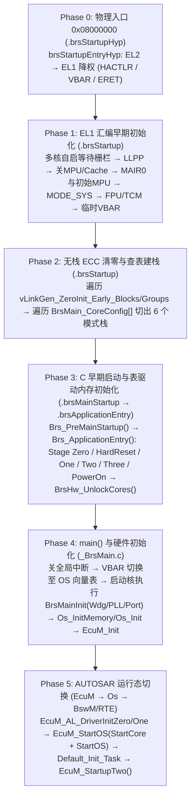

# DemoComponents 启动机制分析与本工具实现说明

本文基于 `D:\davinci\mcuapp\DemoComponents` 源码、预配置 ARXML 及 `StartApplication` 生成样例，系统梳理 Vector MICROSAR（以 Tongxin THA6206 / ARM Cortex-R52 为例）从硬件复位到 AUTOSAR OS/BSW 运行态的完整启动机制，并明确该机制在本工具（`autosar_configurator`）架构中的映射关系、实现路径与关键集成约束。

---

## 1. `DemoComponents` 目录全景与职责划分

`D:\davinci\mcuapp\DemoComponents` 共包含 6 个组件目录，其中 **`vBaseEnv` + `vBRS` + `vLinkGen`** 构成 ECU 启动链路的核心铁三角：

| 组件 | 定位 | 核心内容（静态实现 + 生成/预配置产物） |
| --- | --- | --- |
| **`vBaseEnv`** | **架构与芯片底层启动 + 硬件抽象** | 汇编复位入口、EL2→EL1 切换、MPU/Cache/FPU/TCM 初始化、启动临时异常表、芯片复位原因/看门狗/PLL/端口/多核解锁实现（`_ARMStartup_CortexR52.c`、`_ARMStartup_Platform.h`、`_ARMBrsHw_CortexR52.c/.h`、`_ARMBrsHwIntTb_CortexR52.c`、`_BrsHw.c/.h`）；同时通过 `vBaseEnv_THA6_pre.arxml`、`vBRS_THA6_pre.arxml`、`vLinkGen_BaseEnv_rec.arxml` 向 `vBRS` 和 `vLinkGen` 注入芯片衍生参数与启动段定义 |
| **`vBRS`** | **芯片无关的通用启动状态机与 `main()` 框架** | 表驱动多阶段 RAM 初始化引擎（`_BrsMainStartup.c`）、`main()` 与各核初始化任务 `Default_Init_Task*`（`_BrsMain.c`）、用户可编辑回调桩（`_BrsMain_Callout_Stubs.c`）、专用段映射（`_Brs_MemMap.h`）；生成器产出 `vBrsCfg.h`、`vBrs_Lcfg.h/.c`、`Makefile.config.generated` |
| **`vLinkGen`** | **内存布局与启动初始化表的单一数据源** | 依据内存区域与段组配置，同源生成链接脚本（`vLinkGen_Template.ld`）与分阶段/分核初始化表（`vLinkGen_Cfg.h`、`vLinkGen_Lcfg.h/.c`），完全取代 C 运行库 `__main`/`__scatterload` |
| `vItaHlp` | 驱动/外设集成测试辅助 | CAN/LIN/ETH/SPI/FLS/WDG/MCU 等集成测试辅助代码，不参与主启动链路 |
| `MppdGenerator` | 构建脚本辅助 | DaVinci Groovy 自动化脚本，用于生成 Makefile 工程宏 |
| `VttvBaseEnv` | 虚拟目标机适配 | CANoe / vVIRTUALtarget（`VVIRTUALTARGET`）下的 `BrsHw.h` 替代实现 |

### 设计核心思想

Vector 将**芯片差异**、**启动逻辑**、**工程内存布局**彻底解耦：

- 静态代码（`vBaseEnv` + `vBRS`）原则上跨工程复用，不硬编码具体项目的内存区段和核数量；
- 工程级差异全部收敛到 3 组生成产物：
  1. **硬件与特性宏**：`vBrsCfg.h`、`Makefile.config.generated`；
  2. **核映射与启动栈/向量表索引表**：`vBrs_Lcfg.h/.c` 中的 `BrsMain_CoreConfig[]`；
  3. **链接脚本与分阶段初始化表**：`vLinkGen_Template.ld` + `vLinkGen_Cfg.h` + `vLinkGen_Lcfg.h/.c`。

---

## 2. 完整上电启动链路（Phase 0 ～ Phase 5）



### Phase 0：物理复位入口与 EL2 → EL1 降权

- **源码位置**：`DemoComponents/vBaseEnv/Implementation/_ARMStartup_CortexR52.c`（L107–166）
- **链接固定布局**（`StartApplication/Appl/Source/vLinkGen_Template.ld` L18–31）：
  - `0x08000000`（`StartupCode_Hypervisor_FirstExecInst`）：`.brsStartupHyp`（`brsStartupEntryHyp`）
  - `0x08000100`（`CoreExceptions_FirstExecInst`）：`.brsExcVect` + `.brsExcVectConst`（`intvect_CoreExceptions`）
  - `0x08000140`（`StartupCode_FirstExecInst`）：`.brsStartup` + `.brsMainStartup`
  - `0x08000940`（`ApplicationEntry`）：`.brsApplicationEntry`（`Brs_ApplicationEntry`）
  - `0x1003FFD0`（`Variables_Shared`）：`.brsSharedVar`（存放 `brsMain_ResetReason`、`BrsHw_CoreStart[]`）
- **执行动作**（当 `BRS_FIRST_EXECUTION_INSTANCE` 定义且 `BRS_ENABLE_HYPERVISOR_MODE_HANDLING == STD_ON`）：
  1. 可选执行 `brsPreAsmStartupHookHyp`；
  2. 写 `HACTLR = 0x0000B783` 放开 EL1 访问权限；
  3. 配置 `SPSR_hyp` 为 `MODE_SVC`（可选设置 T 位）、将 `VBAR` 指向临时 `EL1_VectorTable`、设置 `ELR_hyp` 并通过 `DSB / ISB / ERET` 降权到 EL1，跳入 `brsStartupEntry`（同时导出 `_start`、`_start_c1`～`_start_c3` 符号供 OS 多核启动引用）。

### Phase 1：多核自启同步栅栏与核底层寄存器配置

- **源码位置**：`_ARMStartup_CortexR52.c`（L189–413）、`_ARMStartup_Platform.h`、`_BrsHw.h`（L106–128）
- **关键步骤**：
  1. **多核同步栅栏（`BRSHW_CORES_AUTOSTART`）**：THA6 平台定义了 `BRSHW_INIT_CORE_ID = 0`、`BRSHW_CORE_START_PATTERN = 0xAA5555AA`。硬件上电若所有核同时释放，非启动核读取 `MPIDR` 计算物理核号后，会在 `coreWaitLoop` 轮询共享变量 `BrsHw_CoreStart[coreID]`；直到启动核完成内存初始化并在 `Brs_ApplicationEntry()` 末尾调用 `BrsHw_UnlockCores()` 写入同步字后，从核才清除该同步字并继续独立执行后续步骤。
  2. **基础核寄存器与 MPU/Cache/FPU**：
     - 使能低延迟外设口 `IMP_PERIPHPREGIONR`；
     - 关闭 MPU、D-Cache、I-Cache，清 `SCTLR.TE`（确保异常以 ARM 模式进入）；
     - 循环禁用全部 MPU Region；
     - 配置 `MAIR0`：`Attr0 = 0x44`（Normal Non-Cacheable，避免 DMA 一致性问题）、`Attr1 = 0x00`（Device-nGnRnE）；
     - 配置初始 MPU Region：Region 15 外设（必选）、Region 14 Flash 代码、Region 13 SRAM 数据、Region 12 TCM；
     - 切换至 `MODE_SYS` 并清 `CPSR.A` 异步中止屏蔽；使能 MPU 及 EL1 背景区（`SCTLR.BR`），按宏可选使能 Cache 与 FPU（`CPACR` CP10/CP11 + `FPEXC.EN`）。
  3. **按核使能 TCM 与临时异常表**：
     - 依据 `_ARMStartup_Platform.h` 中的 `brsTcmBase[core][0..2]`，向 `IMP_xTCMREGIONR`（`c9, c1, #0/#1/#2`）写入 ATCM/BTCM/CTCM 基址、大小编码与 `ENABLEEL10` 位；
     - 设置 `VBAR = intvect_CoreExceptions`（定义在 `_ARMBrsHwIntTb_CortexR52.c`，异常时停留在 `BrsHw_CoreExceptionHandler` 方便调试器定位）。

### Phase 2：无栈 ECC 早期清零与查表初始化多模式栈

- **源码位置**：`_ARMStartup_CortexR52.c`（L420–648）
- **关键步骤**：
  1. **Early 阶段纯汇编清零**：在 C 栈尚未可用之前，汇编按 16 字节步长遍历 `vLinkGen_ZeroInit_Early_Blocks` 和 `vLinkGen_ZeroInit_Early_Groups`（字段布局：`Start` / `End` / `Core` / `Alignment`），遇到全零哨兵项结束，按当前 `CoreID` 过滤；若 `Alignment == 8` 使用 `STMIA R3!, {R7, R8}` 执行 64 位写（满足 8 字节 ECC RAM 初始化要求），否则按 4 字节 `STR` 清零。
  2. **查表建栈**：汇编读取 `vBrs_Lcfg.c` 中的 `BrsMain_CoreConfig_Size` 与 `BrsMain_CoreConfig[]`，以 `28` 字节为步长比对偏移 `+4` 的 `PhysicalCoreId`；未命中则跳转 `BrsMainExceptionStartup()`。命中后从偏移 `+8` 读取 `StartupStackEndLabel`（即 `_STACK_C<n>_LIMIT`），从栈顶依次向下切出 6 个 ARM 模式栈（每个递减 `MODE_STACK_SIZE = 0x40` 字节）：
     `MODE_ABT` → `MODE_IRQ` → `MODE_FIQ` → `MODE_UNDEF` → `MODE_SVC` → `MODE_SYS`（剩余空间供 C 阶段与 `main()` 使用）。
  3. 跳转 `BL Brs_PreMainStartup` 进入 C 运行环境。

### Phase 3：C 早期启动与表驱动多阶段 RAM 初始化

- **源码位置**：`DemoComponents/vBRS/Implementation/_BrsMainStartup.c`、`_BrsMain_Callout_Stubs.c`、`StartApplication/Appl/GenData/vLinkGen_Lcfg.c`
- **关键步骤**：
  1. **`Brs_PreMainStartup()`**（仅首执行实例编译）：
     - 若定义 `BRSHW_EARLYINIT_AVAILABLE`，调用 `BrsHwEarlyInitPowerOn()`（THA6 上写 `0x40080080 = 0` 关闭 SMPU，放行 HSM 访问主机内存）；
     - 仅启动核调用 `BrsHwGetResetReasonStartup()` 读取 `RCC_RESET_RSTSTAT` 区分软件复位（`BRSMAIN_RESET_SW`）与其他复位（`BRSMAIN_RESET_OTHER`），并写入共享变量 `brsMain_ResetReason`（避免二次读寄存器丢状态）；
     - 调用 `Brs_ApplicationEntry()`。
  2. **`Brs_ApplicationEntry()`**（固定在 `.brsApplicationEntry` 段，非首实例如 FBL/Appl 由前级 BootManager 直接跳入）：
     - 按固定阶段流水线依次调用用户钩子（定义于 `_BrsMain_Callout_Stubs.c`）、`Brs_MemoryZeroInit()` 和 `Brs_MemoryInit()`（仅当对应 `VLINKGEN_CFG_NUM_* > 1uL` 时编译执行，且每次仅初始化 `Areas[i].Core == coreID` 的条目）：
       - **Stage Zero**：`BrsMain_MemoryInit_StageZero_Hook` → `ZeroInit_Zero_Groups` → `Init_Zero_Groups`
       - **Stage HardReset**：`BrsMain_MemoryInit_StageHardReset_Hook`（若开启 `BRS_ENABLE_PREFER_PLL_WATCHDOG_INIT`，会提前在此处执行看门狗和 PLL 初始化以加速大内存清零）→ **仅当 `brsMain_ResetReason != BRSMAIN_RESET_SW` 时**执行 `HardReset_Blocks` / `HardReset_Groups` / `Init_HardReset_Groups`
       - **Stage One**（常规主阶段，承载绝大多数 `.bss`/`.data`/OS/MSR/PBCfg）：`StageOne_Hook` → `One_Blocks` → `One_Groups` → `Init_One_Groups`
       - **Stage Two / Stage Three**：扩展阶段（例如外扩 RAM 控制器在钩子中初始化后再初始化对应段）
       - **Stage PowerOn**：`StagePowerOn_Hook` → `PowerOn_Groups` / `Init_PowerOn_Groups`（对应 AUTOSAR `POWER_ON_CLEARED` / `POWER_ON_INIT`）
     - 底层实现：`Brs_MemoryZeroInit()` 在 THA6 上走 `_BrsHw.h` 内联汇编 `BrsHw_AsmMemoryZeroInitLoop`（`stm` 批量写入 + `dmb`）；未提供汇编实现时按 `Alignment`（0/4 走 32 位、8 走 64 位）写；`Brs_MemoryInit()` 将 ROM 初始值拷贝到 RAM 并检查 `RAM 长度 >= ROM 长度`。
  3. **多核解锁与进入 `main()`**：
     - 执行 `BrsMain_PreMainHook(coreID)`；
     - 多核且开启 `BRSHW_CORES_AUTOSTART` 时，启动核调用 `BrsHw_UnlockCores(coreID)` 写入 `BrsHw_CoreStart[0..N-1] = 0xAA5555AA` 唤醒等待中的从核；
     - 调用 `main()`。

### Phase 4：`main()` 硬件初始化与切换至 OS/EcuM

- **源码位置**：`DemoComponents/vBRS/Implementation/_BrsMain.c`（L1080–1200）、`_BrsHw.c`（L4986–5060）
- **关键步骤**：
  1. `BrsHwDisableInterruptAtPowerOn()`：置位 `CPSR.I/F` 屏蔽 IRQ/FIQ；
  2. 遍历 `BrsMain_CoreConfig[]`：
     - 调用 `BrsHw_ExceptionTable_Init(ExcVecLabel, IntVecLabel)`，写 `VBAR` 将异常表从启动临时表切换为 OS 正式向量表 `_OS_EXCVEC_CORE<n>_CODE_START`；
     - 检查非 AUTOSAR 核（`CoreIsAsr == NON_ASR`）：可选由启动核调 `StartNonAutosarCore()`，非 ASR 核自身标记跳转 `BrsMain_NonAsrCore_Hook()`；
  3. 仅启动核调用 `BrsMainInit()`：
     - `BrsMain_Appl_Init()` → `BrsHwWatchdogInitPowerOn()` → `BrsHwPllInitPowerOn()`（校验 `BRS_TIMEBASE_CLOCK <= BRS_CPU_MAX_FREQUENCY`、`BRS_PERIPH_CLOCK == 25`、`BRS_OSC_CLK == 25`，执行 THA6 `Flash_Hal_PFlashSwitchFreq()` 切 400 MHz 时序及 `Rcc_Init()`）→ `BrsHwPortInitPowerOn()` → 初始化 1 ms 周期回调表；
  4. 按运行模式分发入口（永不返回）：
     - 常规 AUTOSAR 应用：各核执行 `Os_InitMemory()` → `Os_Init()` → `EcuM_Init()`；
     - 特殊变体：FBL 无 EcuM 进 `FblMain()`；HSM 进 `vHsm_Init()`；Hypervisor 进 `vHyp_InitMemory()` / `vHyp_Init()` / `vHyp_Start()`；OS Interrupt-Only 进 `Os_InitInterruptOnly()`。

### Phase 5：AUTOSAR 阶段衔接（`EcuM` → `Os` → `BswM/RTE`）

- **源码位置**：`StartApplication/Appl/Source/EcuM_Callout_Stubs.c`（L253–364）、`_BrsMain.c`（L403–730）
- **关键步骤**：
  1. `EcuM_AL_DriverInitZero()`：在 BSW 核上执行各 BSW 模块 `*_InitMemory()` 与 `Det_Init()`；
  2. `EcuM_AL_DriverInitOne()`：在 BSW 核上执行 `Mcu_Init()`、`Mcu_InitClock()` + 等 PLL 锁 + `Mcu_DistributePllClock()`，随后执行 `BswM/ComM/PduR/CanTp` `*_PreInit()` 及 `Port/Can/Spi/Dsadc` `*_Init()`；
  3. `EcuM_StartOS()`：多核模式下启动核循环调用 `StartCore()`，所有核调用 `StartOS(appMode)`；
  4. OS 启动后自动调度 `vBRS` 定义的自启任务：
     - `Default_Init_Task`（单核/主核）及 `Default_Init_Task_Core0..6`（多核）调用 `EcuM_StartupTwo()`（触发 `BswM_Init`、`SchM_Init`、`Rte_Start`），完成后 `TerminateTask()`；
     - `Default_Init_Task[_Core<n>]_Trusted` 调用 `Os_InitialEnableInterruptSources(FALSE)`（独立拆分以兼容 SafeContext 分区场景）。

---

## 3. 静态代码与生成产物的四大底层契约

在本工具中复现或对接该启动机制时，以下 4 条静态源码强约束**不可破坏**：

1. **固定地址启动段契约**
   - 链接文件必须显式放置 `.brsStartupHyp`、`.brsExcVect`、`.brsExcVectConst`、`.brsStartup`、`.brsMainStartup`、`.brsApplicationEntry` 与 `.brsSharedVar`（且 `.brsSharedVar` 不可在阶段 One 被误清，以免破坏 `brsMain_ResetReason` 和 `BrsHw_CoreStart[]`）。
2. **`brsMain_CoreType` 结构体内存布局契约**
   - `_ARMStartup_CortexR52.c` 汇编按固定步长 `28` 字节遍历 `BrsMain_CoreConfig[]`，并在偏移 `+4` 读 `PhysicalCoreId`、偏移 `+8` 读 `StartupStackEndLabel`，因此结构体字段顺序与对齐不可变更。
3. **链接符号与哨兵项契约**
   - `vBrs_Lcfg.c` 通过 `_ARMBrsHw_CortexR52.h` 宏固定引用 `_STACK_C<n>_LIMIT` 和 `_OS_EXCVEC_CORE<n>_CODE_START`；
   - `vLinkGen_Lcfg.c` 的每张初始化表末尾必须附加一条全零哨兵项，且 `vLinkGen_Cfg.h` 的 `VLINKGEN_CFG_NUM_*` 计数包含该哨兵项（空表计数为 `1u`）。
4. **ECC 写入粒度与版本门禁契约**
   - `_BrsMainStartup.c` 仅允许 `Alignment ∈ {0, 4, 8}`，传入任何其他值（例如直接把链接段 `ALIGN 64` 写入表项）都会触发 `BrsMainExceptionHandler(kBrsMissingFunctionality, ...)`；
   - `VLINKGEN_CFG_MAJOR_VERSION` 必须为 `2u`，`VLINKGEN_CFG_MINOR_VERSION` 需 `>= 16u`（建议统一生成 `19u`，同时兼容 `BrsMain 0x0221` 与 `0x0223`）。

---

## 4. 本工具设计中的实现方案

结合仓库既有规划（`docs/superpowers/specs/2026-11-06-vbrs-eb-templates-design.md` 与 `openspec/changes/add-vbrs-eb-templates/`）以及本工具当前的 **Format 8 模块包 + 芯片 YAML 库 + `core/memmap` 统一布局生成器** 架构，建议按以下 4 层落地：

### 4.1 架构映射总表

| Vector 原机制 | 本工具承接模块 | 核心职责与设计原则 |
| --- | --- | --- |
| `vBaseEnv` 衍生芯片预配置（`vBaseEnv_THA6_pre.arxml`） | **芯片 YAML 库**<br>`autosar_configurator/data/chips/*.yaml`<br>`autosar_configurator/core/hardware/memory_regions.py` | 保持芯片 YAML 为唯一硬件真相，不另设 `vBaseEnv` 配置模块 |
| `vBRS` 配置生成器（`vBrsCfg.h`、`vBrs_Lcfg.h/.c`、`Makefile.config.generated`） | **Format 8 模块包 + EB 模板引擎**<br>`template_packs/vBRS/`<br>`autosar_configurator/generator/eb_template_engine.py` | 用标准 EB 模板渲染 4 个 vBRS 文件，逻辑写在模板内并逐分支对齐 JAR |
| `vLinkGen` 链接文件与初始化表（`scatter.scat` + `vLinkGen_Cfg.h` / `vLinkGen_Lcfg.h/.c`） | **内存布局统一 Plan 引擎**<br>`autosar_configurator/core/memmap/plan.py`<br>`autosar_configurator/core/memmap/symbols.py`<br>`autosar_configurator/core/memmap/generators/ads.py` | **禁止用两套计算**：链接文件与 `vLinkGen_*` 必须由同一份 `Plan` 同步派生，保证符号名、起止地址、加载地址 100% 一致 |
| 静态启动代码与编译器桥接 | Vector 静态 `BrsMain`/`BrsHw` + `BrsMain_Callout_Stubs.c` + armlink steering 文件 | 不改 Vector 静态核心源码；平台缺口优先进表，其次进回调文件 |

### 4.2 各层详细实现要点

#### （1）芯片数据层（取代 `vBaseEnv_THA6_pre.arxml`）
在 `autosar_configurator/data/chips/THA6206_LFBGA292.yaml` 及 `MemoryRegionDef` 中补齐 5 类元数据（缺失时在 `chip_completeness` 报出，严禁静默猜值）：
- 修正 `cpu_frequency` 为 `400000000`（400 MHz，否则 `BrsHw.c:5006` 在 `BRS_TIMEBASE_CLOCK > BRS_CPU_MAX_FREQUENCY` 时编译报错）；
- 芯片级字段：`vector_derivative`（`Tongxin_THA6206`）、`core_type`（`CORTEX_R52`）；
- 窗口级字段：`ecc_alignment`（TCM 填 `8`，其余 RAM 暂填 `4` 并标 `unconfirmed`）；
- 窗口级字段：`early_zero_init_core`（按原厂商 `startup.c` 的 ITMU 清零清单标记：各核清各自 ATCM/BTCM/CTCM，Core 0 另清 LMU1/LMU2/LMU3），用于派生 `vLinkGen_ZeroInit_Early_Blocks`。

#### （2）vBRS 配置接入与 EB 模板层
1. **BSWMD 与参数类型补齐**：直接引用 SIP 中的 `DemoComponents/vBRS/BSWMD/vBRS_bswmd.arxml`（不拷入仓库）；在 `definition_model.py` / `ecuc_def_parser.py` / `ecuc_serializer.py` 与配置面板补齐 `ECUC-MULTILINE-STRING` 支持，以完整往返 `vBRSMakefileUserCode`。
2. **显式输出文件名映射**：扩展 `CodeGenerator` 支持模板包声明固定输出文件名（`vBrsCfg.h`、`vBrs_Lcfg.h`、`vBrs_Lcfg.c`、`Makefile.config.generated`），不再受限于 `{Module}_*` 命名约定。
3. **跨模块数据输入**：
   - 开关与时钟：通过 `as:modconf('vBRS')` 读取（含经 `vBRSMcuClockReferencePointForBrsPeriphClock` 关联 Mcu 时钟参考点）；
   - 核映射：读取自研/EB `Os` 的 `OsCoreIdMappingConfig`（逻辑核号、物理核号）与 `OsApplicationCoreRef`；
   - 启动栈大小：读取存储布局中对应核 `STACK_C<n>` 区域尺寸；
   - 严格防呆：缺少 vBRS 模块、开启多核但无 Os 核映射、缺某核 `STACK_C<n>`、或芯片缺 `core_type`/`cpu_frequency` 时立即报错中止生成。

#### （3）`core/memmap` 统一 Plan 与 `vLinkGen_*` 生成层
1. **布局模型扩展**（`core/memmap/config.py` & `plan.py`，全部为向后兼容的可选字段）：
   - `init_stage`：`EARLY` / `ZERO` / `HARD_RESET` / `ONE`（默认）/ `TWO` / `THREE` / `POWER_ON` / `NO_INIT`；
   - `owner_core`：默认按窗口自动推断（核私有窗口归该核；核本地别名窗口如 `CPUXATCM`/`CPUXCTCM` 每核各派生一条同地址表项；共享窗口归启动核），支持按区域覆盖；
   - `alignment`：默认继承所属窗口 `ecc_alignment`，强校验仅允许 `0`、`4`、`8`。
2. **启动必选段与独立启动栈**：
   - 在 `factory.py` / `rules.py` 中纳入 `.brsStartupHyp`、`.brsExcVect`/`.brsExcVectConst`、`.brsStartup`/`.brsMainStartup`、`.brsApplicationEntry`、`.brsSharedVar` 的固定/专属区域映射；
   - 为每核在对应 TCM 中创建独立启动栈区域 `STACK_C<n>`（**不复用**自研 OS 的 `CORE<n>_USER_STACK`，并校验尺寸 `>= 6 * 0x40 + 最小余量`）以及向量表区域 `OS_EXCVEC_CORE<n>_CODE`，缺失时阻断生成。
3. **表项生成与覆盖率门禁**：
   - **复制表（`Init`）**：凡“加载地址 ≠ 执行地址”的区域（含 RAM 代码、向量表、clone 区与初始化数据）全部生成 `vLinkGen_RamMemArea` 条目；
   - **清零表（`ZeroInit`）**：所有 BSS 区域以及 Data 区域中的 ZI 部分生成 `vLinkGen_MemArea` 条目；
   - **不进表**：`NOINIT`、`STACK` 及原地执行 Flash `CODE`/`CONST`；
   - **Early 块表**：由芯片窗口 `early_zero_init_core` 直接生成 `vLinkGen_ZeroInit_Early_Blocks`；
   - **确定性排序与防漏检查**：表项按区域名排序；生成时校验所有 RW/ZI 与需拷贝区域均已覆盖，遗漏即报错。

#### （4）ADS 工具链（`armclang` + `armlink`）适配策略
- **符号表**：在 `core/memmap/symbols.py` 中复用 ADS 符号规则，`vLinkGen_Lcfg.c` 直接引用 `Image$$<R>$$Base`、`Image$$<R>$$Limit` 与 `Load$$<R>$$Base`；
- **关闭数据压缩**：因为完全绕过 `__main`/`__scatterload`，必须在 `scatter.scat` 注释与生成报告中明确要求链接参数 `--datacompressor=off`；
- **静态代码编译器分支与符号桥接**：当前 `DemoComponents/vBaseEnv` 下的 R52 静态文件仅开放 `BRS_COMP_LLVMHIGHTEC` 分支（`armclang` 同属 Clang 前端）。在不修改 Vector 静态源码的前提下：
  - 先通过可行性探针验证 `armclang -DBRS_COMP_LLVMHIGHTEC` 编译静态 `BrsMain`/`BrsHw`；
  - 链接阶段用 `armlink` steering 文件（`RESOLVE ... AS ...`）将 `_STACK_C<n>_LIMIT` 和 `_OS_EXCVEC_CORE<n>_CODE_START` 映射到对应的 `Image$$` 符号（若后续获得 Vector 的 Arm6 版 `BrsHw`，则直接切换 `BRS_COMP_ARM6`）。

---

## 5. 取代厂商 `startup.c` 时的 5 项集成缺口与落点原则

用 `vBaseEnv` + `vBRS` + `vLinkGen` 接管原厂商 `doc/THA6XXX_MC_AS440/.../Startup/startup.c` 后，需逐项核对以下 5 个非内存/接口缺口，并严格遵循 **“能进表优先进表 → 其次放进用户回调 `BrsMain_Callout_Stubs.c` → 必须改内核或 Vector 核心源码时先评审确认”** 的落点顺序：

| 缺口项 | 差异说明 | 处理与落点建议 |
| --- | --- | --- |
| **1. OS 启动入口接口** | `BrsMain.c` 固定调用 `Os_InitMemory()`、`Os_Init()`、`Os_InitialEnableInterruptSources()`、`StartNonAutosarCore()` | 自研 OS 需补齐这几个符号的定义（或提供薄适配层），并将 OS 向量表段放入 `OS_EXCVEC_CORE<n>_CODE` |
| **2. 多模式栈交接** | `_ARMStartup_CortexR52.c` 仅给 ABT/IRQ/FIQ/UNDEF/SVC/SYS 各分配 `0x40` 字节临时启动栈 | 核对自研 OS 进入后是否将各模式栈重设为内核自己的 `CORE<n>_{USER,FIQ,IRQ,UNDEFINED,ABORT,KERNEL}_STACK`；若不重设须扩大启动栈切分或由 OS 初始化重设 |
| **3. THA6 特有硬件勘误** | 厂商 `startup.c` 含 `Startup_SetTCMAddr`（ARM 勘误 CPU.H001）等板级操作，而 `BrsHw` 只写核内 `IMP_xTCMREGIONR` | 逐行对照 `startup.c` 与 `BrsHw`，确认缺失项后优先放进 `brsPreAsmStartupHook` 或 `BrsMain_Callout_Stubs.c`；原 ITMU 清 RAM 则由 `vLinkGen_ZeroInit_Early_Blocks` 64 位清零取代 |
| **4. 多核启动策略防冲突** | `BrsHw` 默认假设上电全核自启（`BRSHW_CORES_AUTOSTART` + `BrsHw_UnlockCores`），而厂商 `startup.c` 有 `Startup_StartSlaveCore`，`EcuM_StartOS` 又调用 `StartCore()` | 明确硬件复位时从核状态：全核自启走 `BrsHw_UnlockCores`；受控拉起则禁用 `BRSHW_CORES_AUTOSTART` 并由 `StartCore()` 统一拉起，避免双重拉起或栅栏死锁 |
| **5. `UNCLEAR_RAM_BSS` 语义** | 厂商 `startup.c` 对 `UNCLEAR_RAM_BSS` 有独立清零策略 | 在 `core/memmap` 中明确其 `init_stage`（`NO_INIT`、`HARD_RESET` 或 `POWER_ON`），确保热复位语义一致 |

---

## 6. 推荐落地路线与验收标准

实施顺序直接衔接 `openspec/changes/add-vbrs-eb-templates/tasks.md`：

1. **可行性探针（阻塞项）**：临时目录复制样例静态 `BrsMain`/`BrsHw`，用 `armclang -DBRS_COMP_LLVMHIGHTEC` + `armlink` steering 文件完成编译与符号映射验证。
2. **启动步骤逐项对照**：输出厂商 `startup.c` vs `vBaseEnv/BrsHw` 完整对照表与 `BrsMain_Callout_Stubs.c` 补丁草稿。
3. **芯片数据与多行参数**：更新 `THA6206_LFBGA292.yaml` 新增字段与完整性校验；补齐 `ECUC-MULTILINE-STRING` 读写与 UI 编辑。
4. **vBRS 模板与 DaVinci 对照**：按 `vBRS.jar` 反汇编分支建立矩阵夹具，实现 `template_packs/vBRS/` 4 份 EB 模板，去文件头后与 `DVCfgCmd` 输出逐字节一致。
5. **`memmap` 扩展与 `vLinkGen_*` 同源生成**：扩展 `Plan` 与 ADS 符号表，同步产出 `scatter.scat` + `vLinkGen_Cfg.h` / `vLinkGen_Lcfg.h/.c`，通过覆盖率与对齐检查。
6. **ADS 自动化链接检查**：新增 `tools/brs_link_check` 编译链接并解析 `.map` 文件，断言所有符号已解析、每条初始化表项起止/加载地址与区域边界一致、每核启动栈顶等于 `STACK_C<n>` 上界。


Analyzed startup.c:L1-800
Analyzed startup.c:L801-1158
Analyzed startup.h:L1-36
Analyzed startup_ads.h:L1-699
Analyzed ARMStartup_Platform.h:L1-119
Ran inspect OS project directory layout
Ran search OS kernel for stack, StartCore, VBAR, and init APIs
Analyzed ARMStartup_CortexR52.c:L101-654
Analyzed Os_link_Lcfg.c:L1-503
Ran list OS project make/ads and startup files
Analyzed Os_kernel.c:L850-1100
Analyzed exception.s:L1-220
Analyzed startup_optimize.c:L1-42
Analyzed Build_Config_ads.mak:L1-80
Ran check OS kernel stack/VBAR/init/CNTKCTL references
Analyzed exception.s:L221-369
Analyzed startup.c:L1-400
Analyzed startup.c:L401-686
Analyzing Os.h:L1400-1470
Analyzed Os_kernel.c:L830-860
Ran check BrsHw.c for slave core ctrl, TCM, CNTKCTL, XIP MPU
Analyzed BrsHw.c:L6220-6296
Analyzed BrsHw.c:L4870-4980

已完成 **Task 2**（逐行对照厂商 [startup.c](file:///d:/bsw-------main/bsw------/doc/THA6XXX_MC_AS440/DemoWorkspace/CodeProject/Startup/startup.c)、自研 OS 工程 [Os_kernel.c](file:///D:/Test001_tr002_THA6_OS_Project/Os/kernel/Os_kernel.c) / [exception.s](file:///D:/Test001_tr002_THA6_OS_Project/SDK/platform/startup/exception.s) 与 Vector `BrsHw`/`BrsMain` 静态源码）。

---

## 一、启动步骤逐项对照表（Task 2.1 & 2.2）

> 落点优先级：**① 初始化表（`vLinkGen_*`） → ② 用户回调（`BrsMain_Callout_Stubs.c`） → ③ 需确认/改内核或静态代码（标记“待用户决策”）**

| # | 厂商 `startup.c` 步骤与源码位置 | Vector `BrsHw` / `BrsMain` 现状 | 差异与实证风险 | 归属与落点 |
| --- | --- | --- | --- | --- |
| **1** | **EL1 六模式独立栈**<br>[startup.c#L932-L1032](file:///d:/bsw-------main/bsw------/doc/THA6XXX_MC_AS440/DemoWorkspace/CodeProject/Startup/startup.c#L932-L1032)：设 `CORE<n>_{USER,FIQ,IRQ,UNDEFINED,ABORT,KERNEL}_STACK`（每块 4 KB） | [ARMStartup_CortexR52.c#L605-L623](file:///D:/davinci/mcuapp/Applications/SipAddon/StartApplication/Appl/Source/ARMStartup_CortexR52.c#L605-L623) 仅从 `STACK_C<n>` 切出 `MODE_STACK_SIZE = 0x40`（**64 B**）/模式 | **严重崩溃风险**：实查 [Os_kernel.c](file:///D:/Test001_tr002_THA6_OS_Project/Os/kernel/Os_kernel.c) 全库，**自研 OS 从未重设 `sp_irq`/`sp_svc`/`sp_abt`/`sp_und`/`sp_fiq`**；且 [exception.s#L274-L296](file:///D:/Test001_tr002_THA6_OS_Project/SDK/platform/startup/exception.s#L274-L296) 的 `EL1_IRQHandler` 仅保存现场+VFP 就压栈 **312 字节**，`EL1_FIQHandler` 向 `sp_svc` 压栈 >300 字节。64 B 栈首次中断即踩爆内存 | **② `BrsMain_Callout_Stubs.c`**<br>在 `BrsMain_PreMainHook(coreId)` 中，用 `MSR sp_abt/sp_und/sp_irq/sp_fiq/sp_svc` 重设为 `CORE<n>_*_STACK` 栈顶（保持当前 `sp_sys` 留在 `STACK_C<n>` 供 `main()` 运行至 `StartOS`） |
| **2** | **TCM 基址寄存器（ARM 勘误 5.2 CPU.H001）**<br>[startup.c#L109-L120](file:///d:/bsw-------main/bsw------/doc/THA6XXX_MC_AS440/DemoWorkspace/CodeProject/Startup/startup.c#L109-L120), [startup_ads.h#L308-L316](file:///d:/bsw-------main/bsw------/doc/THA6XXX_MC_AS440/DemoWorkspace/CodeProject/Startup/startup_ads.h#L308-L316)：`BTCM = 0x30100027/0x30500027`（AXI 全局地址），`CTCM = 0x0020001F`（别名），`ATCM` 保持复位默认 `0x0`（别名） | [ARMStartup_CortexR52.c#L384-L404](file:///D:/davinci/mcuapp/Applications/SipAddon/StartApplication/Appl/Source/ARMStartup_CortexR52.c#L384-L404) 写 `IMP_xTCMREGIONR`（EL1/0 使能）。<br>• `StartApplication` 版 [ARMStartup_Platform.h#L107-L116](file:///D:/davinci/mcuapp/Applications/SipAddon/StartApplication/Appl/Include/ARMStartup_Platform.h#L107-L116)：`ATCM=0x1C`、`BTCM=0x30100024/0x30500024`、`CTCM=0x0020001C`（与厂商一致）<br>• `DemoComponents` 新版 [_ARMStartup_Platform.h#L123-L132](file:///D:/davinci/mcuapp/DemoComponents/vBaseEnv/Implementation/_ARMStartup_Platform.h#L123-L132)：`ATCM=0x3000001C/0x3040001C`、`CTCM=0x3020001C/0x3060001C`（**取消本地别名**） | 使用 `StartApplication` 版即已覆盖 CPU.H001；**若换用 `DemoComponents` 新版且布局含 `CPUXATCM`/`CPUXCTCM` Clone 窗口，访问 `0x0`/`0x00200000` 会直接 Abort** | **已覆盖（版本强约束）**<br>锁定采用 `StartApplication` 版 `brsTcmBase`（或将 TCM 布局与所选版本强一致校验） |
| **3** | **EL2 Hyp 栈与临时 SVC 栈**<br>[startup.c#L818-L870](file:///d:/bsw-------main/bsw------/doc/THA6XXX_MC_AS440/DemoWorkspace/CodeProject/Startup/startup.c#L818-L870), [#L1107-L1153](file:///d:/bsw-------main/bsw------/doc/THA6XXX_MC_AS440/DemoWorkspace/CodeProject/Startup/startup.c#L1107-L1153)：`0x10000200/0x10000400` 临时栈 + `CORE<n>_HYP_STACK` | [ARMStartup_CortexR52.c#L104-L162](file:///D:/davinci/mcuapp/Applications/SipAddon/StartApplication/Appl/Source/ARMStartup_CortexR52.c#L104-L162) 在 EL2 全程纯汇编无函数调用，直接 `ERET` 进 EL1；EL1 建栈前也全程无栈 | 非虚拟化场景运行时不再陷入 EL2，**不需要**硬编码 GMU 临时栈，也无需为启动配置 `CORE<n>_HYP_STACK` | **无需补充**（已由纯汇编降权替代） |
| **4** | **从核硬件拉起与多核同步**<br>[startup.c#L296-L364](file:///d:/bsw-------main/bsw------/doc/THA6XXX_MC_AS440/DemoWorkspace/CodeProject/Startup/startup.c#L296-L364)：Core 0 写 `CORE1_CTRL_ADDR (0xC0020C5C) |= 1`（解锁 Endinit）释放 Core 1 | • `StartApplication` 版 [BrsHw.c#L4965-L4976](file:///D:/davinci/mcuapp/Applications/SipAddon/StartApplication/Appl/Source/BrsHw.c#L4965-L4976)：`BrsHwEarlyInitPowerOn()` **已写 `CORE_CTRL_ADDR |= 1`**，Core 1 在 `coreWaitLoop` 等待至 `BrsHw_UnlockCores()`<br>• `DemoComponents` 新版 [_BrsHw.c#L4968-L4972](file:///D:/davinci/mcuapp/DemoComponents/vBaseEnv/Implementation/_BrsHw.c#L4968-L4972)：**删掉了 `CORE_CTRL_ADDR |= 1`**，改为写 `*(0x40080080) = 0` 关 SMPU | 实查 [Os_kernel.c#L1043-L1084](file:///D:/Test001_tr002_THA6_OS_Project/Os/kernel/Os_kernel.c#L1043-L1084)：**自研 OS `StartCore()` 只置软件同步位图 `OsKernel_StartCore_SyncPoint_1`，不写硬件寄存器 `0xC0020C5C`**。<br>• 用 `StartApplication` 版 `BrsHw.c` 时两套机制**无冲突且刚好衔接**（硬件释放 → `BrsHw_UnlockCores` → `StartOS` 等 `StartCore` 位图）。<br>• 若升级到 `DemoComponents` 新版 `_BrsHw.c`，Core 1 将永远停在 Halt | **已覆盖（`StartApplication` 版）**；<br>若用新版 `_BrsHw.c` 或后续扩展 THA6412（Core2/3），须在 **② `BrsMain_Callout_Stubs.c`**（`StageZero_Hook`）补写 `CORE<n>_CTRL_ADDR`；另需确认是否使用 HSM（若用 HSM，v01.01.03 缺关 SMPU `0x40080080 = 0`） |
| **5** | **`UNCLEAR_RAM_BSS` 特殊清零**<br>[startup.c#L262-L269](file:///d:/bsw-------main/bsw------/doc/THA6XXX_MC_AS440/DemoWorkspace/CodeProject/Startup/startup.c#L262-L269)：`if (RST_POWERON == RSTSTAT)` 才清零（`RSTSTAT=0xC0000800`, `RST_POWERON=0x00800000`） | `BrsMainStartup.c` 提供两套阶段：<br>• `HardReset` 阶段仅在 `brsMain_ResetReason != BRSMAIN_RESET_SW` 时清零（软复位保持，外部/看门狗/POR 均清）<br>• `PowerOn` 阶段默认无条件清零（注释要求项目自定义条件） | 若业务语义允许“软复位保持、硬复位/POR 清零”，可直接入 `HardReset` 表；若要求**严格仅 POR 清零**，必须做条件清零 | **① 初始化表（`HARD_RESET`）或 ② `StagePowerOn_Hook`**（**待用户决策 Q1**） |
| **6** | **ITMU 硬件清 RAM（ECC 初始化）**<br>[startup.c#L589-L679](file:///d:/bsw-------main/bsw------/doc/THA6XXX_MC_AS440/DemoWorkspace/CodeProject/Startup/startup.c#L589-L679)：每核清各自 ATCM/BTCM0/BTCM1/CTCM，Core 0 另清 LMU1/2/3；**不清 GMU** | [ARMStartup_CortexR52.c#L425-L473](file:///D:/davinci/mcuapp/Applications/SipAddon/StartApplication/Appl/Source/ARMStartup_CortexR52.c#L425-L473)：无栈遍历 `vLinkGen_ZeroInit_Early_Blocks`，`Alignment=8` 时用 `STMIA` 64 位写满足 ECC | 完全可替代 ITMU 且无 GIPC 锁依赖；**切记 Early Blocks 不可包含 GMU**（否则会冲掉 `.brsSharedVar` 的 `BrsHw_CoreStart[]` 及 `UNCLEAR_RAM_BSS`） | **① 初始化表**<br>由芯片 YAML 窗口 `early_zero_init_core` 派生 `vLinkGen_ZeroInit_Early_Blocks`（仅 TCM + LMU1/2/3） |
| **7** | **段拷贝与 BSS 清零**<br>Clone 区（`INT_VECTOR_TABLE`/`CODE_CLONE`/`DATA_CLONE`）、每核私有 `PRIVATE_CODE/DATA_CORE<n>`、全局 `UNDEFINE_RAM_*` / `GLOBAL_UNCACHED_*` / `LMU1..3_*` | `Brs_ApplicationEntry()` 按核遍历 `vLinkGen_ZeroInit_One_Groups` 和 `vLinkGen_Init_One_Groups` | Clone 区位于本地别名窗口（`CPUXATCM`/`CPUXCTCM`），必须对每个核生成 1 条同地址不同 `Core` 字段的表项 | **① 初始化表**<br>由 `core/memmap/plan.py` 统一派生 `vLinkGen_Lcfg.c`，覆盖率强制校验 |
| **8** | **【新发现】`CNTKCTL.PL0PCTEN = 1`**<br>[startup.c#L1061-L1066](file:///d:/bsw-------main/bsw------/doc/THA6XXX_MC_AS440/DemoWorkspace/CodeProject/Startup/startup.c#L1061-L1066)：允许 EL0（非信任任务）读物理计数器（`Stm_Hal_GetValue`） | `BrsHw` **完全缺失** | 若工程含非信任 EL0 任务读取 STM/物理计数器，缺失该位会直接触发 Undefined Instruction 异常 | **② `BrsMain_Callout_Stubs.c`**<br>在 `BrsMain_PreMainHook(coreId)` 中每核置位 `CNTKCTL.PL0PCTEN` |
| **9** | **【新发现】XIP MPU 保护与 Cache/BusTimeout**<br>[startup.c#L905-L925](file:///d:/bsw-------main/bsw------/doc/THA6XXX_MC_AS440/DemoWorkspace/CodeProject/Startup/startup.c#L905-L925)（MPU 0/1 护 `0x50000000`/`0xA0000000` XIP）、[#L569-L580](file:///d:/bsw-------main/bsw------/doc/THA6XXX_MC_AS440/DemoWorkspace/CodeProject/Startup/startup.c#L569-L580)（`IMP_CSCTLR`/`BUSTIMEOUT`）、[#L1056-L1059](file:///d:/bsw-------main/bsw------/doc/THA6XXX_MC_AS440/DemoWorkspace/CodeProject/Startup/startup.c#L1056-L1059)（D-Cache） | `StartApplication` 版 `ARMStartup_Platform.h` 的 `MPU_CODE/DATA/TCM_REGION` 均为 `STD_OFF`、`BRS_ENABLE_CACHE = STD_OFF`、`MAIR0 Attr0 = 0x44`（Non-Cacheable）；自研 OS 的 `Os_PreInit()` 在配置了 `MpuConfigSetRef` 时会重配 MPU | 若不启用 OS MPU，启动期无 XIP 保护；若需开 Cache，需同步调整 `MAIR0` 与 MPU 属性 | **② `BrsMain_Callout_Stubs.c`（可选宏控）**或由 **OS MPU 配置接管**（**待用户决策 Q2**） |
| **10** | **【新发现】进 `main` 前开全局中断 `cpsie if`**<br>[startup.c#L1072](file:///d:/bsw-------main/bsw------/doc/THA6XXX_MC_AS440/DemoWorkspace/CodeProject/Startup/startup.c#L1072) | [BrsMain.c#L1101](file:///D:/davinci/mcuapp/DemoComponents/vBRS/Implementation/_BrsMain.c#L1101) 在 `main()` 入口显式关中断，延后到 OS `Default_Init_Task_Trusted` 使能 | Vector 策略更符合 AUTOSAR 规范，避免 OS 未就绪时误进 ISR | **无需补充**（遵循 Vector 行为） |
| **11** | **【集成前置项】OS 接口与异常向量表**<br>`BrsMain.c` 调用 `Os_InitMemory()`、`Os_Init()`、`Os_InitialEnableInterruptSources()`；`BrsHw_ExceptionTable_Init` 写 `VBAR = _OS_EXCVEC_CORE<n>_CODE_START` | 实查自研 OS：仅定义 [Os_PreInit()](file:///D:/Test001_tr002_THA6_OS_Project/Os/kernel/Os_kernel.c#L846)，未定义上述 3 个 MICROSAR Os API；EL1 异常向量表 `Startup_EL1ExceptionTable` 原本寄居在 [startup_ads.h#L188](file:///d:/bsw-------main/bsw------/doc/THA6XXX_MC_AS440/DemoWorkspace/CodeProject/Startup/startup_ads.h#L188) 中 | `startup.c` 退出后，需把 OS EL1 异常向量表迁出到独立文件并放入 `.OS_EXCVEC_CORE<n>_CODE` 段，并薄封装 3 个 OS 初始化接口 | **③ 整机集成适配层（待用户决策 Q3）**（不改 Vector 核心源码） |

---

## 二、`BrsMain_Callout_Stubs.c` 补丁草稿（Task 2.2）

> 说明：仅利用 Vector 预留的用户回调文件 `BrsMain_Callout_Stubs.c`，**不修改任何 Vector 静态核心文件**；遵循 MISRA-C:2012 风格，针对 ADS (`armclang`) 语法编写。

```c
/* --- 置于 BrsMain_Callout_Stubs.c 顶部 --- */
#include "BrsMain.h"

/* THA6206 复位状态寄存器（用于严格 POR 判定，仅在 Q1 选择严格 POR 清零时启用） */
#define THA6_RCC_RSTSTAT_REG     (*(volatile uint32 *)(0xC0000800UL))
#define THA6_RCC_RST_POWERON_MSK (0x00800000UL)

/* 每核 EL1 异常/内核模式栈顶（由 ADS scatter 的 CORE<n>_*_STACK 区域提供） */
extern uint8 Image$$CORE0_ABORT_STACK$$ZI$$Limit[];
extern uint8 Image$$CORE0_UNDEFINED_STACK$$ZI$$Limit[];
extern uint8 Image$$CORE0_IRQ_STACK$$ZI$$Limit[];
extern uint8 Image$$CORE0_FIQ_STACK$$ZI$$Limit[];
extern uint8 Image$$CORE0_KERNEL_STACK$$ZI$$Limit[];

#if (BRS_CPU_CORE_AMOUNT > 1u)
extern uint8 Image$$CORE1_ABORT_STACK$$ZI$$Limit[];
extern uint8 Image$$CORE1_UNDEFINED_STACK$$ZI$$Limit[];
extern uint8 Image$$CORE1_IRQ_STACK$$ZI$$Limit[];
extern uint8 Image$$CORE1_FIQ_STACK$$ZI$$Limit[];
extern uint8 Image$$CORE1_KERNEL_STACK$$ZI$$Limit[];
#endif

static inline void BrsCallout_SetModeStacks(
    uint32 abtTop, uint32 undTop, uint32 irqTop, uint32 fiqTop, uint32 svcTop)
{
  /* 自研 OS 不重设非 SYS 模式栈，且 EL1_IRQHandler/EL1_FIQHandler 现场压栈 >300B，
     必须将 BrsHw 切出的 64B 临时模式栈切换为内核配置的独立栈区。
     不能触碰当前正在使用的 SP_sys（STACK_C<n>），直到 StartOS 切入 Task 栈。 */
  __asm volatile(
      "msr sp_abt, %0 \n"
      "msr sp_und, %1 \n"
      "msr sp_irq, %2 \n"
      "msr sp_fiq, %3 \n"
      "msr sp_svc, %4 \n"
      "isb            \n"
      :
      : "r"(abtTop), "r"(undTop), "r"(irqTop), "r"(fiqTop), "r"(svcTop)
      : "memory");
}

static inline void BrsCallout_EnablePl0PhysicalCounter(void)
{
  uint32 cntkctl = 0u;
  /* 允许 EL0 非信任任务读取物理计数器（对应厂商 startup.c:1064-1066 Stm_Hal_GetValue 需求） */
  __asm volatile("mrc p15, 0, %0, c14, c1, 0" : "=r"(cntkctl) : : "memory");
  cntkctl |= 0x1UL;
  __asm volatile("mcr p15, 0, %0, c14, c1, 0\n isb" : : "r"(cntkctl) : "memory");
}

/* 若 Q1 确认 UNCLEAR_RAM_BSS 必须严格仅 POR 清零（而非 HardReset 清零），可启用此钩子： */
#if defined(BRS_CALLOUT_STRICT_POR_UNCLEAR_BSS)
extern uint8 Image$$UNCLEAR_RAM_BSS$$Base[];
extern uint8 Image$$UNCLEAR_RAM_BSS_LIMIT$$ZI$$Base[];

void BrsMain_MemoryInit_StagePowerOn_Hook(uint32 coreId)
{
  if ((coreId == BRSHW_INIT_CORE_ID) && (THA6_RCC_RSTSTAT_REG == THA6_RCC_RST_POWERON_MSK))
  {
    volatile uint32 *ptr = (volatile uint32 *)Image$$UNCLEAR_RAM_BSS$$Base;
    volatile uint32 *end = (volatile uint32 *)Image$$UNCLEAR_RAM_BSS_LIMIT$$ZI$$Base;
    while (ptr < end)
    {
      *ptr = 0UL;
      ptr++;
    }
  }
}
#endif

void BrsMain_PreMainHook(uint32 coreId)
{
  if (coreId == 0u)
  {
    BrsCallout_SetModeStacks(
        (uint32)Image$$CORE0_ABORT_STACK$$ZI$$Limit,
        (uint32)Image$$CORE0_UNDEFINED_STACK$$ZI$$Limit,
        (uint32)Image$$CORE0_IRQ_STACK$$ZI$$Limit,
        (uint32)Image$$CORE0_FIQ_STACK$$ZI$$Limit,
        (uint32)Image$$CORE0_KERNEL_STACK$$ZI$$Limit);
  }
#if (BRS_CPU_CORE_AMOUNT > 1u)
  else if (coreId == 1u)
  {
    BrsCallout_SetModeStacks(
        (uint32)Image$$CORE1_ABORT_STACK$$ZI$$Limit,
        (uint32)Image$$CORE1_UNDEFINED_STACK$$ZI$$Limit,
        (uint32)Image$$CORE1_IRQ_STACK$$ZI$$Limit,
        (uint32)Image$$CORE1_FIQ_STACK$$ZI$$Limit,
        (uint32)Image$$CORE1_KERNEL_STACK$$ZI$$Limit);
  }
#endif
  else
  {
    BrsMainExceptionHandler(kBrsInvalidCoreConfig, BRSERROR_MODULE_BRSMAIN, (uint16)(__LINE__));
  }

  BrsCallout_EnablePl0PhysicalCounter();
}
```

---

## 三、需要你确认的 3 个决策问题

1. **Q1（`UNCLEAR_RAM_BSS` 语义）**：采用方案 A（放入 `vLinkGen_ZeroInit_HardReset_Groups`，软复位保持、硬复位/POR 清零，零手写清零代码），还是方案 B（严格等价厂商 `startup.c`，设为 `NO_INIT` 并在 `StagePowerOn_Hook` 仅在 `RSTSTAT == 0x00800000` 时清零）？
2. **Q2（XIP MPU 保护 & HSM SMPU）**：当前目标工程是否启用 OS MPU（从而接管 XIP 保护），以及是否启用 HSM（决定是否需要在 `BrsHw.c` v01.01.03 外额外补写 `*(0x40080080) = 0` 关 SMPU）？
3. **Q3（落盘与继续推进）**：是否批准将本 Task 2 对照表与回调草稿写入 [openspec/changes/add-vbrs-eb-templates/startup-comparison.md](file:///d:/bsw-------main/bsw------/openspec/changes/add-vbrs-eb-templates/startup-comparison.md)（并勾选 [tasks.md](file:///d:/bsw-------main/bsw------/openspec/changes/add-vbrs-eb-templates/tasks.md) 的 2.1/2.2），然后继续推进 **Task 3（芯片数据字段）** 或 **Task 4（多行字符串参数）**？