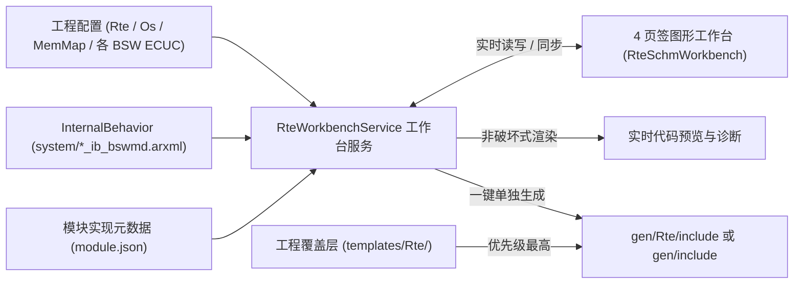

# RTE / SchM 图形化配置与生成工作台使用指南

> 适用范围：AUTOSAR BSW 图形配置工具 — 阶段 1（Phase 1）RTE / SchM 模型驱动配置与头文件生成工作台（`RteSchmWorkbench`）  
> 目标读者：刚接触 AUTOSAR Classic、BSW、SchM 与 RTE 配置的初学者与集成工程师

---

## 目录

- [1. 基础概念快速入门](#1-基础概念快速入门)
- [2. 启动入口与保存机制](#2-启动入口与保存机制)
- [3. 初学者 6 步快速上手](#3-初学者-6-步快速上手)
- [4. 工作台顶部状态摘要栏](#4-工作台顶部状态摘要栏)
- [5. 四个页签逐项详解](#5-四个页签逐项详解)
  - [5.1 页签 1：1. BSW 实例与同步](#51-页签-11-bsw-实例与同步)
  - [5.2 页签 2：2. 临界区矩阵 (SchM)](#52-页签-22-临界区矩阵-schm)
  - [5.3 页签 3：3. Task 调度映射](#53-页签-33-task-调度映射)
  - [5.4 页签 4：4. 全局开关与生成预览](#54-页签-44-全局开关与生成预览)
- [6. 输出文件清单与阶段 1 能力边界](#6-输出文件清单与阶段-1-能力边界)
- [7. 常见问题与排查 (FAQ)](#7-常见问题与排查-faq)

---

## 1. 基础概念快速入门

在使用工作台之前，先用一句话理解界面中反复出现的 8 个核心术语：

| 术语 | 全称/对应文件 | 初学者通俗解释 |
|---|---|---|
| **BSW** | Basic Software（如 `Com`、`CanIf`、`Dcm`、`EcuM`） | 汽车嵌入式里的底层驱动与基础服务协议栈。 |
| **SchM** | BSW Scheduler（`SchM_<ApiName>.h`） | BSW 调度器，负责两件事：① 声明 `MainFunction` 周期函数入口；② 生成 `SchM_Enter_*` / `SchM_Exit_*` 临界区加锁宏。 |
| **RTE** | Runtime Environment（`Rte.h`、`Rte_Cfg.h`、`Rte_Main.h` 等） | 连接上层应用（SWC）、底层 BSW 和操作系统 OS 的统一运行时胶水层。 |
| **IB (`_ib_bswmd`)** | InternalBehavior（`system/**/*_ib_bswmd.arxml`） | 厂商随模块附带的“内部行为说明书”，声明了模块有哪些可调度实体（`BSW-SCHEDULABLE-ENTITY`）、定时事件（`BSW-TIMING-EVENT`）与临界区（`EXCLUSIVE-AREA`）。 |
| **ExclusiveArea** | `RteBswExclusiveAreaImpl` / `EXCLUSIVE-AREA` | 临界区。用于保护同一核中断或不同任务/核并发访问共享数据，防止读写错乱。 |
| **Task Mapping** | `RteBswEventToTaskMapping` | 任务映射。决定 BSW 的周期函数挂在哪个 `OsTask` 下执行，以及同一个 Task 里的先后调用顺序。 |
| **MemMap** | `<Module>_MemMap.h` 或 `MemMap.h` | 内存段映射头文件，控制函数声明放在哪个代码段（`CODE`）或内存分区。 |
| **工程覆盖层 (`overlay`)** | `templates/Rte/` | 工程级定制模板目录。若工程存在定制 `Rte_*.h` 或 `SchM_*.h` 模板，生成时优先使用覆盖模板输出。 |

工作台与工程各模型、输出产物之间的数据流如下：



---

## 2. 启动入口与保存机制

### 如何打开工作台

1. 在工程根目录启动工具：
   ```bash
   python davinci_main.py
   ```
2. 在主窗口中通过 `File → Open Project...` 打开包含 `Rte` 模块的工程（如 `.dpa` 工程）。
3. 打开后，在菜单栏点击以下任意一个入口即可弹出工作台：
   - **`Generate → RTE / SchM 工作台...`**
   - **`Tools → RTE / SchM 工作台...`**

> [!NOTE]
> 在 macOS 下，菜单栏默认位于**屏幕最顶部系统状态栏**，而不是窗口内部。

### 修改如何保存、撤销与取消（重要）

- 工作台中的操作会实时更新内存副本并驱动第 4 页签预览；底层支持完整的 **打开前快照与基线 Pre 锁（`PreLockedError`）校验**：
  - 点击底部 **`恢复打开前状态`**：可随时将全部修改一键回滚到刚打开工作台时的状态（不关闭弹窗）。
  - 点击 **`取消`**（或按 `Esc` / 关闭弹窗）：放弃本次在工作台内的所有修改并回滚到打开前状态，不会污染主工程。
  - 点击 **`确定`**：正式提交本次修改，工具会自动把整次修改封装为一条撤销记录压入主窗口 **`Undo` 栈（支持 `Ctrl+Z` / `Cmd+Z` 一键撤销整次工作台修改）**，同时刷新跨模块引用与反向引用索引、点亮 **`Save Project`** 按钮。
  - **受 Pre 锁保护的项**：如果项目使用了 Format 8 Baseline Pre 锁定了某个参数或容器，修改会被拦截并提示解锁。
- **在主窗口按 `Ctrl+Shift+S`（`Save Project`）** 才会把已确认的修改正式写入磁盘 `config/Rte.arxml`。
- 例外：第 4 页签点击 **`立即生成 RTE / SchM`** 会直接把 C 头文件写到 `gen/` 输出目录，无需等保存工程。

---

## 3. 初学者 6 步快速上手

如果你导入了一个 DaVinci `.dpa` 工程，建议按以下顺序从左到右过一遍 4 个页签：

1. **检查页签 1（`1. BSW 实例与同步`）**：确认用到的 BSW 模块都处于绿色“活跃 (将生成 SchM)”；若有红色“未加载 (将跳过)”且工程确实不需要的残留模块，可选中后移除；勾选“补齐缺失临界区”点 **`一键同步`**。
2. **检查页签 2（`2. 临界区矩阵 (SchM)`）**：看最右侧 **`状态/校验`** 列，确保没有红色报错行。初学者绝大多数临界区保持默认 **`ALL_INTERRUPT_BLOCKING`** 即可。
3. **检查页签 3（`3. Task 调度映射`）**：左侧查看各 `OsTask` 中已挂载的 `MainFunction` 与执行 **`序号`**；如右侧“未映射 BSW 调度事件”有需要运行的周期事件，选定 **`目标 OsTask`** 后点 **`映射到选中 Task`**。
4. **检查页签 4（`4. 全局开关与生成预览`）**：核对“阶段 1 生效开关”（如 `RteEnableMultiCore`）及下方 ECUC 预留参数；在左下 **`模型诊断与告警`** 确认没有 `[错误]`，点击左侧文件名预览生成出的 `.h` 内容。
5. **生成头文件**：确认无误后点击 **`立即生成 RTE / SchM`**，必要时点 **`打开输出目录`** 查看生成的头文件。
6. **确认与保存工程**：点击工作台右下角 **`确定`** 提交修改（若反悔可点 **`取消`** 或之后在主窗口 **`Ctrl+Z` 撤销**），最后在主窗口按 **`Ctrl+Shift+S`** 保存 `Rte.arxml`。

---

## 4. 工作台顶部状态摘要栏

打开工作台后，弹窗最顶部显示一行实时汇总信息及辅助按钮：

```text
工程：<工程名>  |  活跃 BSW 实例：<N>  |  未加载：<M>  |  临界区：<K>（错误 <E>）   [当前变体提示]   [重新扫描 IB]
```

| 字段 / 控件 | 含义 |
|---|---|
| **工程** | 当前打开的工程名。 |
| **活跃 BSW 实例** | `RteBswModuleInstance` 中引用了工程已加载模块的实例数，每个都会生成对应的 `SchM_<ApiName>.h` 与 `SchM_<ApiName>_Type.h`。 |
| **未加载** | `Rte` 中有登记，但当前工程未加载对应模块配置（或配置为空）的实例数；生成时会自动跳过并在诊断区发出告警。 |
| **临界区（错误 E）** | 全部活跃 BSW 实例下的临界区总数及校验错误数；当 `E > 0` 时，第 4 页签的生成按钮会防呆禁用。 |
| **当前变体提示（橙色）** | 当工程当前处于非 `Default` 变体时出现，提示“工作台修改作用于基础层”。 |
| **`重新扫描 IB` 按钮** | 为保证编辑流畅，工作台打开时仅扫描一次 `system/` XML 并缓存；如果你在外部增改了 `*_ib_bswmd.arxml`，点此按钮显式重扫并刷新 4 个页签。 |

---

## 5. 四个页签逐项详解

### 5.1 页签 1：`1. BSW 实例与同步`

此页签用于对比 **`Rte` ECUC 登记的实例**、**工程实际加载的模块** 与 **IB 文件信息**，解决“模块增删后 `Rte` 与工程脱节”的问题。

#### 顶部工具栏与选项

| 控件 | 类型 | 说明与操作方式 |
|---|---|---|
| **`添加到 Rte 实例`** | 按钮 | 当表格选中状态为 **未在 Rte 注册（橙色）** 的行时启用。点击会在 `Rte` 中创建 `RteBswModuleInstance` 容器，自动填充 `RteBswModuleConfigurationRef`（`/ActiveEcuC/<模块>`）、解析 `RteBswImplementationRef`，并按 IB 自动补齐初始 `RteBswExclusiveAreaImpl`。 |
| **`移除实例`** | 按钮 | 当表格选中状态为 **活跃（绿色）** 或 **未加载（红色）** 的行时启用。从 `Rte` 配置中删除该 `RteBswModuleInstance`（并清理交叉引用索引）。 |
| **`补齐缺失临界区`** | 勾选框 | 默认勾选。点击 **`一键同步`** 时，将活跃模块中“仅 IB 声明但 ECUC 尚未创建”的临界区写入 `Rte` ECUC（默认 `ALL_INTERRUPT_BLOCKING`）。 |
| **`补齐未注册 BSW 模块`** | 勾选框 | 默认不勾选。勾选后点击 **`一键同步`**，会为所有 **未在 Rte 注册** 的普通 BSW 模块批量创建 `RteBswModuleInstance`。注：`Rte`、`Os`、`EcuC`、`MemMap` 等系统/基础设施模块仅在其确有 IB 实体或临界区时才会进入待注册建议列表。 |
| **`清理未加载实例`** | 勾选框 | 默认不勾选。勾选后点击 **`一键同步`**，会自动删掉所有红色 **未加载** 的残留实例。 |
| **`一键同步`** | 按钮 | 按上述 3 个勾选框执行批量同步，并弹窗汇总：`新增实例 X 个，补齐临界区 Y 项，清理未加载实例 Z 个`。 |
| **右侧统计标签** | 只读文本 | 实时显示 `活跃 A | 未加载 B | 未注册 C`。 |

#### 表格 8 列说明

| 列名 | 含义说明 |
|---|---|
| **`模块`** | 目标 BSW 模块名（优先从 `RteBswModuleConfigurationRef` 解析，如 `Com`、`CanIf`、`CanTrcv_Tle9255`）。 |
| **`状态`** | • **活跃 (将生成 SchM)**（绿色）：`Rte` 已注册且工程已加载该模块。<br>• **未加载 (将跳过)**（红色）：`Rte` 中有 `RteBswModuleInstance`，但工程里未加载该模块（如禁用掉的 `CanNm`）。<br>• **未在 Rte 注册**（橙色）：工程已加载该模块，但 `Rte` 尚未建立 `RteBswModuleInstance`。 |
| **`SchM API 名称`** | 最终生成的 `SchM_<ApiName>.h` 及宏前缀使用的 API 名称。一般等于模块名；若模块元数据或 IB 中同时存在 `vendor_id` 与 `vendor_api_infix`，按 `<模块>_<vendor_id>_<vendor_api_infix>` 拼接（例如 `CanTrcv_30_Tle9255`）。 |
| **`MemMap 头文件`** | 对应 `SchM_*.h` 中引入的内存映射头文件名。优先读取 IB/包元数据中的 `MEMMAP` Artifact 声明（如 `MemMap.h`），否则对含内存段或 AR 4.3+ 模块使用 `<ApiName>_MemMap.h`，其余回退 `MemMap.h`。未加载模块显示 `-`。 |
| **`调度实体`** | 从 IB 的 `BSW-SCHEDULABLE-ENTITY` 中解析出的可调度实体数量（对应写入 `SchM_*.h` 的函数声明数）。 |
| **`临界区 (已配/IB)`** | 格式为 `<ECUC 已配置数量> / <IB 声明数量>`。若左边小于右边（例如 `1 / 2`），说明存在仅在 IB 声明、尚未写入 `Rte` ECUC 的临界区。 |
| **`Task 映射`** | 该实例下已指定目标 Task（存在 `RteBswMappedToTaskRef`）的 `RteBswEventToTaskMapping` 数量。 |
| **`IB 来源`** | 匹配到的 `system/` 下 `*_ib_bswmd.arxml` 文件相对路径；未匹配到时显示 `-`。 |

---

### 5.2 页签 2：`2. 临界区矩阵 (SchM)`

此页签以表格矩阵形式集中配置所有活跃 BSW 模块的 `SchM_Enter_*` / `SchM_Exit_*` 临界区保护机制。每一次下拉选择或勾选都会实时同步写入 `Rte` ECUC，并立刻更新第 4 页签的 `SchM_*.h` 代码预览。

#### 筛选栏与批量操作栏

| 控件 | 含义与用法 |
|---|---|
| **`模块` 下拉框** | 默认 `全部模块`，可筛选查看单个 BSW 模块下的临界区。 |
| **搜索框** | 支持按 `ExclusiveArea` 名称、模块名或 API 名称关键字实时模糊搜索。 |
| **`仅看未配置/有错误`** | 勾选后仅保留“仅 IB (待同步)”或包含红色校验错误的行，便于快速定位问题。 |
| **`同步缺失临界区`** | 将全部状态为 **`仅 IB (待同步)`** 的行写入 `Rte` ECUC，赋予默认机制 `ALL_INTERRUPT_BLOCKING`。 |
| **`选中行批量设置保护机制` + 目标下拉 + `应用到选中行`** | 在表格中支持 `Shift`/`Cmd` 多选行，在左侧选择目标机制（如选 `OS_RESOURCE` / `OS_SPINLOCK` 时中间下拉框会列出工程的 `OsResource` / `OsSpinlock` 供选择），点击 **`应用到选中行`** 一次批量更新多条临界区。 |
| **右侧统计标签** | 实时显示 `共 X 项 | 未同步 Y | 错误 Z`。 |

#### 表格 8 列说明

| 列名 | 含义说明 |
|---|---|
| **`模块`** | BSW 模块名称。 |
| **`API 名称`** | SchM 前缀名（决定生成的宏名形式 `SchM_Enter_<API名称>_<ExclusiveArea>()`）。 |
| **`ExclusiveArea`** | 临界区名称（例如 `COM_EXCLUSIVE_AREA_RX`）。 |
| **`来源`** | • **`ECUC`**：已在 `Rte` 中存在 `RteBswExclusiveAreaImpl` 容器。<br>• **`仅 IB (待同步)`**（橙色）：仅来自 `*_ib_bswmd.arxml`；即使不手动同步，生成器也会按默认 `ALL_INTERRUPT_BLOCKING` 生成并发出告警；你在此行修改任意字段时会自动创建对应 ECUC 容器。 |
| **`保护机制`**（下拉框） | 对应 `RteExclusiveAreaImplMechanism`，共 7 种机制（见下方详解）。 |
| **`OsResource / OsSpinlock`**（下拉框） | 仅在 **`保护机制`** 为 `OS_RESOURCE` 时启用并列出 `Os` 模块中的 `OsResource`；为 `OS_SPINLOCK` 时启用并列出 `OsSpinlock`；其他机制下置灰显示 `-`。 |
| **`生成函数`**（勾选框） | 对应 `RteExclusiveAreaGenerateFunction`。• **不勾选（默认）**：生成 `#define SchM_Enter_...()` / `#define SchM_Exit_...()` 内联宏。<br>• **勾选**：改为生成 `FUNC(void, RTE_CODE) SchM_Enter_...(void);` / `SchM_Exit_...(void);` 函数原型声明（同时对应生成宏会被移除，由用户 `.c` 提供实现）。 |
| **`状态/校验`** | • **正常**（绿色）：配置完整且合法。<br>• **将按 IB 默认生成**（橙色）：未显式同步到 ECUC，生成时按默认机制。<br>• **红色错误提示**：例如“机制为 OS_RESOURCE 但缺少 RteBswExclusiveAreaOsResourceRef”或“缺少 RteBswExclusiveAreaOsSpinlockRef”或“未知机制”。存在错误时，第 4 页签禁止生成，防止产出错误 C 代码。 |

#### 7 种保护机制详解

| 机制枚举值 | 非函数模式下生成的进入 / 退出宏 | 适用场景与初学者建议 |
|---|---|---|
| **`ALL_INTERRUPT_BLOCKING`** | `SuspendAllInterrupts()` / `ResumeAllInterrupts()` | **默认与最常用机制**。全局禁用可屏蔽中断（Cat1 + Cat2），适合执行时间极短（微秒级）的内存读写临界区。 |
| **`OS_INTERRUPT_BLOCKING`** | `SuspendOSInterrupts()` / `ResumeOSInterrupts()` | 仅禁用 OS 管理的 Cat2 中断，不打断最高实时性的 Cat1 硬件中断。 |
| **`OS_RESOURCE`** | `GetResource(<Res>)` / `ReleaseResource(<Res>)` | 通过 OS 优先级天花板资源实现同核任务间互斥，**不关中断**，适合耗时相对稍长的临界区；**必须在下一列选择具体的 `OsResource`**。 |
| **`OS_SPINLOCK`** | `GetSpinlock(<Lock>)` / `ReleaseSpinlock(<Lock>)` | **多核互斥自旋锁**，防止多个核同时访问同一数据；**必须在下一列选择具体的 `OsSpinlock`**。 |
| **`COOPERATIVE_RUNNABLE_PLACEMENT`** | `((void)0)` / `((void)0)` | 依赖 OS 协作式调度或任务同优先级/同 Task 串行放置保证不会抢占，不产生加锁代码。 |
| **`NONE`** | `((void)0)` / `((void)0)` | 显式关闭保护（空操作），仅在确认无并发访问时选用。 |
| **`CUSTOM`** | 生成函数原型 `FUNC(void, RTE_CODE) SchM_Enter_...(void);` / `SchM_Exit_...(void);`（**自动勾选并锁定“生成函数”**） | 用于由用户 `.c` 或工程 `templates/Rte/` 覆盖模板自行实现加锁/解锁函数体。 |

---

### 5.3 页签 3：`3. Task 调度映射`

此页签用于维护 **`RteBswEventToTaskMapping`**，直观查看每个 `OsTask` 中实际执行的调度清单，并分配、调整 BSW 调度事件的执行顺序。

#### 顶部栏

| 控件 | 含义与用法 |
|---|---|
| **过滤框** | 输入任意关键字即可按 Task 名、模块名、事件名或 `MainFunction` 名同时过滤左右两个视图。 |
| **`显示 SWC 映射（只读上下文）`** | 默认勾选。勾选后左侧 `OsTask` 树会一起展示 `RteSwComponentInstance/RteEventToTaskMapping`（以灰色 `SWC (只读)` 标出），方便你看清同一个 Task 内 BSW 与应用层 SWC Runnable 的交错顺序。 |
| **右侧统计标签** | 实时显示 `OsTask M 个 | 已映射事件 N | 未映射 BSW 事件 K`。 |

#### 左侧：`已映射调度顺序（按 OsTask 分组）`

树形控件按 **`OsTask`** 分组，每个子节点按 **`序号`（从小到大，数字小的先执行）** 排列：

| 树列 / 字段 | 父节点（OsTask）显示内容 | 子节点（映射事件）显示内容 |
|---|---|---|
| **`Task / 事件`** | Task 短名称（如 `OsTask_10ms_Core0`）；若在 `Os` 模块中未定义，整行以橙色标记。 | 调度事件名称（如 `Com_MainFunctionRxTimingEvent0`）。 |
| **`模块`** | 空 | 所属 BSW 模块名或 SWC 实例名。 |
| **`实体 / MainFunction`** | Task 摘要信息（优先级 `prio=...`、类型 `BASIC/EXTENDED`、`Os未定义` 提示及挂载项数 `X 项`）。 | 由该事件触发的 C 函数名（`BSW-MODULE-ENTRY` / `MainFunction`，如 `Com_MainFunctionRx`）；无法解析时显示 `-`。 |
| **`序号`** | 空 | BSW 为 `RteBswPositionInTask`，SWC 为 `RtePositionInTask`。未设置时显示 `-`。 |
| **`周期`** | 空 | 从 IB 中 `<PERIOD>` 解析并格式化显示（`< 1s` 显示为 `ms`，如 `10 ms`；`>= 1s` 显示为 `s`）。 |
| **`来源`** | 空 | **`BSW`**（黑色，可编辑）或 **`SWC (只读)`**（灰色，不可通过下方按钮修改）。 |

左侧树下方操作按钮（**仅选中 `BSW` 子节点时可用**，选中 `SWC (只读)` 或 `OsTask` 父节点时置灰）：

| 按钮 | 操作效果 |
|---|---|
| **`上移`** | 将选中的 BSW 事件与同 Task 内上一个相邻 BSW 事件交换 `RteBswPositionInTask`（若同 Task 内有重复序号或空序号，会自动先把 BSW 子项规范化为连续整数 `0..N-1` 再交换）；不会修改 SWC 映射。 |
| **`下移`** | 将选中的 BSW 事件与同 Task 内下一个相邻 BSW 事件交换 `RteBswPositionInTask`；不会修改 SWC 映射。 |
| **`修改序号...`** | 弹出整数输入对话框（范围 `0` ~ `99999`），直接设置该事件的 `RteBswPositionInTask`。 |
| **`取消映射`** | 清除该映射的 `RteBswMappedToTaskRef` 与 `RteBswPositionInTask`，使事件回到右侧“未映射 BSW 调度事件”列表，但保留其 `RteBswEventToTaskMapping` 容器和 `RteBswEventRef`。 |

#### 右侧：`未映射 BSW 调度事件`

列出所有尚未绑定 `OsTask` 的 BSW 调度事件（既包含 `Rte` 里已有 `RteBswEventToTaskMapping` 但还没选 Task 的项，也包含已加载活跃模块在 IB 文件里新发现的事件）：

| 列名 | 含义说明 |
|---|---|
| **`模块`** | 所属 BSW 模块名。 |
| **`事件`** | IB 中的事件名称（如 `Com_MainFunctionTxTimingEvent0`）。 |
| **`实体 / MainFunction`** | 该事件对应的 `MainFunction` 实现入口名称。 |
| **`周期`** | IB 声明的事件周期（例如 `10 ms`、`20 ms`，无周期显示 `-`）。 |
| **`来源`** | • **`ECUC (未映射)`**：`Rte` 中已有 `RteBswEventToTaskMapping` 容器，仅缺少 Task 引用。<br>• **`仅 IB`**（橙色）：仅在 `*_ib_bswmd.arxml` 中声明，尚未在 `Rte` ECUC 中创建容器；执行映射时会自动创建容器。 |

底部映射控制区：
- **`目标 OsTask` 下拉框**：列出 `Os` 模块的所有 `OsTask`（附带优先级信息）以及映射中出现过但 `Os` 中缺少的 Task（标 `[Os中未定义]`）。
  - **便捷联动提示**：点击左侧树中的任意 `OsTask`（或其子事件），右侧 `目标 OsTask` 下拉框会自动切换到该 Task。
- **`映射到选中 Task` 按钮**（或直接 **双击右侧表格行**）：为该事件创建/更新 `RteBswEventToTaskMapping`，绑定 `RteBswMappedToTaskRef` 并将 `RteBswPositionInTask` 设为目标 Task 当前最大序号 `+ 1`（空 Task 从 `0` 开始）。

---

### 5.4 页签 4：`4. 全局开关与生成预览`

此页签将 **`RteGeneration` / `RteBswGeneral` 参数编辑**、**不写磁盘的头文件实时预览**、**模型诊断** 与 **单独生成** 整合在一个界面中。

#### 上半区：全局配置参数（明确区分“阶段 1 生效开关”与“ECUC 预留参数”）

工作台将全局参数拆为两组显示，避免“修改后预览为何无变化”的困惑：

1. **第一组：`阶段 1 生效开关（实时影响 Rte_Main.h 生成结果）`**

| 配置项 | 控件 | 对阶段 1 头文件的直接影响 |
|---|---|---|
| **`RteEnableMultiCore (多核支持)`** | 勾选框 | 写入 `RteGeneration/RteEnableMultiCore`。开启且 `Os` 配置了多个 `OsCore` 时，`Rte_Main.h` 会生成分核启动函数声明（`SchM_StartTiming<CoreSuffix>(void)`），改后立即更新右侧预览。 |
| **`RteDisableRteInitMemory (禁用 Rte_InitMemory)`** | 勾选框 | 写入 `RteGeneration/RteDisableRteInitMemory`。**默认不勾选**；勾选后，`Rte_Main.h` 将不再生成 `Rte_InitMemory(void)` 及各 `OsApplication` 的 `Rte_InitMemory_<App>(void)` 声明，改后立即更新右侧预览。 |

2. **第二组：`ECUC 预留参数（写入 Rte.arxml，供后续阶段 2/3 或外部生成器使用，不改变阶段 1 预览）`**

| 配置项 | 控件 | 说明 |
|---|---|---|
| **`RteEnableMemoryProtection (内存保护)`** | 勾选框 | 写入 `RteGeneration/RteEnableMemoryProtection`（用于内存分区与 OS 保护策略标识）。 |
| **`RteDevErrorDetect (DET 开发错误检测)`** | 勾选框 | 写入 `RteGeneration/RteDevErrorDetect`。阶段 1 的 `Rte.h` 固定提供 `Rte_CallDetReportError` 辅助宏，此标志供阶段 2/3 生成器使用。 |
| **`RteDevErrorDetectUninit (未初始化检测)`** | 勾选框 | 写入 `RteGeneration/RteDevErrorDetectUninit`。 |
| **`RteVfbTraceEnabled (VFB 跟踪)`** | 勾选框 | 写入 `RteGeneration/RteVfbTraceEnabled`。 |
| **`RteSchMVersionInfoApi (SchM 版本查询 API)`** | 勾选框 | 写入 `RteBswGeneral/RteSchMVersionInfoApi`。 |
| **`RteGenerationMode`** | 下拉框 | 写入 `RteGeneration/RteGenerationMode`，可选 `COMPATIBILITY_MODE`（推荐默认）或 `VENDOR_MODE`。 |
| **`RteOptimizationMode`** | 下拉框 | 写入 `RteGeneration/RteOptimizationMode`，可选 `RUNTIME`（推荐）、`MEMORY` 或 `NONE`。 |

#### 中间区：输出目录、生成选项与操作按钮

| 控件 | 含义与行为说明 |
|---|---|
| **`输出目录 (per-module / flat)`** | 自动依据工程配置的 `gen_layout` 展示目标路径：`per-module` 模式指向 `<gen>/Rte/include`，`flat` 模式指向 `<gen>/include`。 |
| **`切换目录...`** | 弹窗选择一个自定义输出根目录用于本次预览和生成（不影响 `.dpa` 工程保存的目录配置）。 |
| **`生成 Rte_Type.h 桩`** | 默认勾选。仅当目标目录中**不存在** `Rte_Type.h` 时生成最小可编译占位桩头文件；若磁盘已存在该文件，则原样保留绝不覆盖。取消勾选时不再创建缺失的 `Rte_Type.h`（注意 `Rte_UserTypes.h` 同样遵守“仅不存在时生成最小桩”的保护规则）。 |
| **`应用 templates/Rte/ 覆盖层`** | 默认勾选。若工程 `templates/Rte/`（或模块包目录名下）存在定制文件（如 `Rte_Cfg.h`、`SchM_Com.h`、`Rte.h`），预览将标为“工程覆盖层”，生成时由模板覆盖模型自动产物。 |
| **`强制覆写未变更文件`** | 默认不勾选。默认采用增量写入（磁盘内容完全一致时跳过写盘、记入“未变化”）；勾选后会强制重写模型产出文件。 |
| **`刷新预览`** | 显式重新从当前工程模型计算文件列表、诊断列表与源码预览（绝不写磁盘）。 |
| **`立即生成 RTE / SchM`** | 仅生成阶段 1 RTE 与 SchM 头文件，不触发工程其他 BSW 模块的重生成。完成后弹窗报告写入数、未变数、保留桩数及跳过的未加载模块。**当诊断区存在红色 `[错误]` 时按钮自动置灰**。 |
| **`打开输出目录`** | 在系统文件管理器中打开当前目标 `include` 目录（目录尚未创建时会弹窗提示）。 |

#### 下半区：输出文件清单、模型诊断与源码预览

1. **左上 `输出文件清单`（3 列：`文件名`、`状态`、`来源`）**：
   - **`状态`** 颜色与含义：
     - **`新建`**（绿色）：目标文件尚不存在，生成时会新建。
     - **`更新`**（蓝色）：磁盘已有同名文件但内容不同，生成时会更新。
     - **`未变化`**（灰色）：磁盘内容已与本次结果完全一致，增量生成时会跳过写盘。
     - **`保留桩文件`**（棕黄色）：`Rte_Type.h` / `Rte_UserTypes.h` 已存在，将安全保留磁盘现有内容。
     - **`工程覆盖层`**（紫色）：命中 `templates/Rte/` 中的工程覆盖模板（预览显示模板文本）。
   - **`来源`**：`model`（模型合成）、`stub`（编译桩）或 `overlay`（工程覆盖模板）。
2. **左下 `模型诊断与告警`**：
   - 🔴 **`[错误]`**：会阻止生成的问题（如 `OS_RESOURCE` 缺目标 Resource 引用、`OS_SPINLOCK` 缺目标 Spinlock 引用、未知机制等）。
   - 🟠 **`[告警]`**：提示性告警（例如跳过未加载模块 `CanNm`、某个临界区仅在 IB 中声明未同步到 ECUC 等），**不会阻止生成**。
   - 🟢 **`校验通过：无错误或告警`**：全部模型就绪，可直接点击生成。
3. **右侧代码预览窗格**：点击左侧任意文件，上方路径栏显示 `<目标完整路径> (<状态> / <来源>)`，下方使用等宽字体展示完整头文件内容。

---

## 6. 输出文件清单与阶段 1 能力边界

### 阶段 1 会生成的文件

| 文件 | 用途说明 |
|---|---|
| `Rte.h` | RTE/SchM 版本宏（`RTE_SW_*_VERSION`、`RTE_VENDOR_ID`）、标准错误码（`RTE_E_*`、`SCHM_E_*`）、Det 辅助宏（`Rte_CheckDetError*`、`Rte_CallDetReportError`）及服务/错误 ID。 |
| `Rte_Main.h` | `SchM_Init`、`SchM_Start`、`SchM_StartTiming*`、`SchM_Deinit`、`Rte_Start`、`Rte_Stop`、`Rte_InitMemory*` 等生命周期函数声明。 |
| `Rte_Cfg.h` | 与 Vector 兼容的最小基础配置头（包含 `"Std_Types.h"`），避免未定义枚举符号导致的 C 编译错误。 |
| `Rte_Cbk.h` | 通信回调总览头文件（如工程包含 `Com` 时引入 `"Com.h"`）。 |
| `SchM_<ApiName>.h` | 为每个**活跃** BSW 实例生成的调度头文件：包含 MemMap 区段包裹下的 `MainFunction` 原型声明、各 `ExclusiveArea` 的 `SchM_Enter_*` / `SchM_Exit_*` 宏（或函数原型），以及必要的 `Os.h` 引入。 |
| `SchM_<ApiName>_Type.h` | 对应模块 SchM 类型 companion 头文件（引入 `"Rte_Type.h"`）。 |
| `Rte_Type.h`、`Rte_UserTypes.h` | 最小可编译桩文件；**仅在目标磁盘路径尚不存在时生成，已存在则永久保留**。 |

### 当前阶段边界说明

- 工作台目前聚焦于 **阶段 1（BSW SchM 头文件 + RTE 核心生命周期/基础配置头文件）**，能够配置 BSW 实例、SchM 临界区、BSW Event-to-Task 映射和 `RteGeneration` 开关，并即时预览与生成头文件。
- **尚未包含的阶段 2 / 阶段 3 能力**：SWC 契约头文件（`Rte_<Swc>.h`）、完整信号/端口数据类型生成（完整 `Rte_Type.h`）、应用层 Data Mapping 界面以及调度实现文件 `Rte.c`（页签 3 中的 SWC 映射目前以**只读上下文**形式展示，不会被误改）。

---

## 7. 常见问题与排查 (FAQ)

<details>
<summary><strong>Q1：为什么我在菜单里找不到，或者点不了「RTE / SchM 工作台...」？</strong></summary>

1. macOS 菜单栏在屏幕最上方系统栏，请查找 **`Generate → RTE / SchM 工作台...`** 或 **`Tools → RTE / SchM 工作台...`**。
2. 未打开工程时该菜单项会置灰；打开包含 `Rte` 的工程后会立即启用。
3. 若工程本身未添加 `Rte` 模块，点击后会提示“当前项目未加载 Rte 模块，请先添加或导入 Rte 模块”。

</details>

<details>
<summary><strong>Q2：在工作台里点错了操作，或者改完想撤销/重开工程怎么恢复？</strong></summary>

1. 还在工作台内时，随时点击左下角 **`恢复打开前状态`**，或直接点右下角 **`取消`**（会整批回滚本次全部改动）。
2. 已经点击 **`确定`** 回到主窗口后，可直接按 **`Ctrl+Z` / `Cmd+Z`** 一键撤销整次工作台的修改。
3. 确认满意后，请务必在主窗口执行 **`File → Save Project`（`Ctrl+Shift+S`）** 写入 `config/Rte.arxml`。

</details>

<details>
<summary><strong>Q3：第 4 页签「立即生成 RTE / SchM」按钮为什么是灰色的？</strong></summary>

当左下角 **`模型诊断与告警`** 中存在红色 **`[错误]`**（常见于把临界区设为 `OS_RESOURCE` 或 `OS_SPINLOCK` 但尚未在下一列选择具体 OS 对象）时，工作台会防呆禁用生成按钮。切换到第 2 页签筛选“仅看未配置/有错误”，补选目标 Resource 或 Spinlock 后按钮会立刻恢复可点击。

</details>

<details>
<summary><strong>Q4：页签 1 出现红色「未加载 (将跳过)」（例如 CanNm）会报错失败吗？</strong></summary>

不会阻止生成。生成时会跳过未加载的模块并给出黄色 `[告警]`。如果工程确实不需要该模块，可以在页签 1 选中它点击 **`移除实例`**，或勾选 **`清理未加载实例`** 后点 **`一键同步`** 彻底清理。

</details>

<details>
<summary><strong>Q5：为什么页签 3 里有些行是灰色的「SWC (只读)」，下方上移/下移按钮点不了？</strong></summary>

灰色行代表应用层 SWC 组件的任务映射（`RteSwComponentInstance/RteEventToTaskMapping`）。工作台把它们一起按 `RtePositionInTask` 排出来，是为了避免你在调整 BSW `MainFunction` 顺序时忽略了同一个 `OsTask` 里已有的应用函数。当前阶段工作台只修改 BSW 的 `RteBswEventToTaskMapping`，不改动 SWC 配置。

</details>

<details>
<summary><strong>Q6：手写了自定义的 Rte_Type.h 或 SchM_Com.h 会不会被一键生成覆盖掉？</strong></summary>

- 若你直接修改磁盘输出的 `Rte_Type.h` 或 `Rte_UserTypes.h`：生成器检测到文件已存在会自动显示为 **`保留桩文件`**，不会覆盖。
- 若你想定制模型生成的头文件内容（如 `Rte_Cfg.h` 或 `SchM_*.h`）：推荐把定制模板放到工程 `templates/Rte/include/` 下并保持勾选 **`应用 templates/Rte/ 覆盖层`**，它会在预览与生成时以最高优先级生效。

</details>
